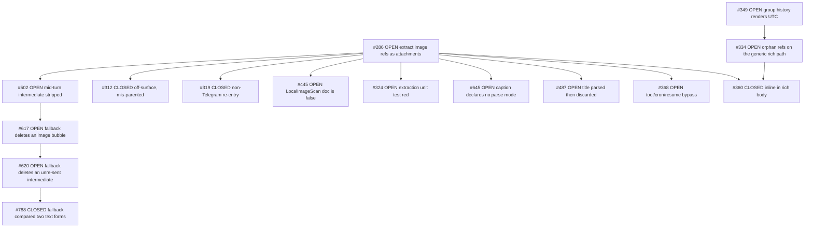
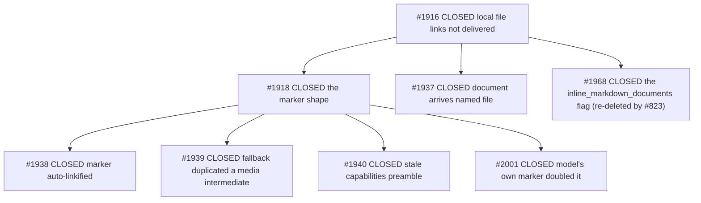

# ADR 0001 — Local file and image delivery on Telegram ("inlining")

- **Status:** Accepted — the owner's intended behaviour (ruling 2026-10-29), **corrected by measurement**
  (revision 3). §2 and §4 now state what the wire actually does; §10 lists every gap between this document
  and the tree, so a reader never has to guess which half is real.
- **Date:** 2026-11-12 (revision 6 — the reference's **form now follows its kind**: `[…]` for a document,
  `![…]` for a photo or a video, after the owner read the two bubbles in his client and only the link form
  opened (#827, §4.2). Revision 5 separated a remote target's two forms after #825 showed §3.2's "never
  fetched" contradicting the fetch step beside it; revision 4 deleted the `.md` exception and §2 lost rule 4,
  after the owner opened an inlined markdown file in the client; revision 3 was the twelve-live-probe rewrite
  of §2, §3.2, §4, §5 and §7; revision 2 was the ruling before anyone had measured the shapes it assumed)
- **Scope:** `src/utils/image.rs` (the reference walks), `src/channels/telegram/delivery.rs` (every plane),
  `src/channels/telegram/intermediates.rs` (promoted bubbles), `src/channels/telegram/rich/` (media array and
  the reference normalizer), `src/config/types.rs` (`TelegramConfig`), `src/brain/prompt_builder.rs` (what
  the model is told)
- **Supersedes:** `ff1425cc5`'s blanket retirement of the document plane (reversed — documents do inline)
  **and** this document's own revision 3, which restored `inline_markdown_documents` as a deliberate
  exception. Revision 4 deletes that exception outright (#823): the client premise it rested on is dead,
  and there is no longer any file the walk refuses (§5). The DM deep link (`21d72dd9b`) is reverted in
  `642724791` and recorded as a rejected alternative (§7).
- **Code state:** `642724791` on fork `main`. Shipped binary is `b2dcf5715` — see §10.

## 1. Context

A model writing a reply cannot upload anything. It writes a **reference to a path on the box**, and the
delivery layer decides what the reader receives:

```markdown
Here is the chart:              
Here is the report:             [Full write-up](/tmp/report.md)
```

Telegram gives a bot three ways to put bytes in front of a reader, and they behave very differently:

| Vehicle | What the reader gets | Can it be addressed later? |
|---|---|---|
| `sendPhoto` / `sendDocument` / `sendVideo` | its own message ("bubble"), openable | yes — a message id exists |
| A `media` entry inside `sendRichMessage` | rendered **inside** the message body | no — it is not a message |
| An `` **embed** — or, for a document, `[…]` **link** — inside a rich body | the media itself, rendered inside the message body — **only** if a `media` entry with an `attach://` source answers that id (§4.1). A photo or a video is a media block and takes the embed; a document takes the link, because an embed aimed at a document id renders nothing in the client (#827) | no |

The whole history of this area is the discovery of which of those three works for which kind of file.
It was not obvious, and three separate assumptions were measured false (§7).

## 2. Decision

**Everything the author references inlines into the rich message body. What decides the ENTRY is the KIND
of the bytes on disk; what decides whether anything attaches at all is the markdown FORM — and the harness
controls the form.** The rich path is the default plane. The detached bubble is what remains when there is
no rich path at all, or when a rich send fails and the fallback ladder takes over. Nothing else holds a
file out: as of revision 4 there is no per-extension exception left (§5).

That second clause is the measurement's contribution, and it inverts revision 2 — then revision 5 inverts part of it
again, on a different instrument. On the wire a reference attaches when it names an entry whose bytes arrive as a
multipart part (`"media": "attach://<name>"`); that much holds. What does NOT hold is the claim that the FORM is
free: revision 4 concluded that only **image syntax** `` attaches, from probes read
back through the API. **The API accepting a reference is not the client rendering it** (#827). Measured in the
client, one daemon, one day apart: the bubble whose document references were written `[label](tg://document?id=…)`
opened when the owner tapped it, and the bubble whose references were written `` was
neither visible nor tappable. A document entry is therefore written back as **LINK** syntax — which is also what
`shield_unresolvable_markdown_images` demotes a live document entry to at send time, so the emit and the repair
now agree instead of the emit depending on the repair.

| # | Rule | Entry emitted | Plane |
|---|---|---|---|
| 1 | A resolvable local reference to an **image** (PNG / JPEG / GIF87a / GIF89a / WEBP / BMP, by magic bytes) renders inline; its bytes ride the rich message's `media` array | `photo` | rich |
| 2 | A resolvable local reference to a **video** renders inline the same way | `video` — **verified live**: `PageBlockVideo`, `video/mp4`, 46 848 B, filename intact | rich |
| 3 | A resolvable local reference to **any other file** — one document kind, every extension — renders inline the same way | `document` — **verified live**: `text/markdown` 37 B and `application/pdf` 200 B | rich |
| 4 | *(deleted in revision 4 — `.md` was the one exception; #823 removed it. Markdown is rule 3.)* | — | — |
| 5 | With **no rich path** — `rich_messages = false`, or a rich send that failed and fell back — every kind ships as its own detached bubble | none | non-rich |
| 6 | The reference is **always rewritten** whatever the author wrote, into the form its **kind** demands: `![…]` for an image or a video, `[…]` (link) for a document — an embed aimed at a document id draws nothing in the client (#827). A caption rides the markdown title (`"…"`) | — | rich |

Three consequences worth stating plainly, because each one used to be the opposite rule:

- **The kind picks the entry AND the form.** `[chart.png](/tmp/chart.png)` and
  `` name the same bytes and must end up identical on the wire — the first
  only because the harness rewrites it. Revision 2 read "the `!` decides nothing" as "syntax is not a
  routing signal"; revision 4 then over-read the API probes as "only `!` attaches"; revision 5 measured the
  client and found the split is BY KIND, not by taste: a photo or a video is a media block and takes `![…]`,
  a document is a link target and takes `[…]`. One rule satisfies all three: the harness claims by content,
  picks the entry by kind, and writes the form that kind actually renders in.
- **The floor never disappears — but it is *attempted*, not *delivered*.** Every kind still has a detached
  leg, and it stays *ungated*: it is what carries the bytes when the rich plane declines, fails, or is
  switched off. An inline entry is an *additional* delivery, never a replacement for a bubble a client can
  open. Revision 3 called that leg "always on", which read as a guarantee; measured over six days it was
  **4 failures in 44 uploads (9.09 %)** — three of them a `Retry after 3s` handed to us and declined, one a
  transport flap. [#815](https://github.com/leshchenko1979/opencrabs/issues/815) closed the retry hole, so
  the leg now sleeps the window it is given and backoffs once on a transport error; a timeout is still
  **not** retried, because an upload that may have landed must not be shipped twice. Ungated means nothing
  gates the attempt. It has never meant the bubble arrives.
- **The rich body is written only if the array answers it.** A `tg://photo` / `tg://video` /
  `tg://document` reference in the body that no media entry resolves renders as dead markdown. This is why
  the reference rewrite and the entry push are one operation and never two (§3.3).

Rule 3 is measured, not intended: a document attaches when its bytes ride the same multipart body and the
body references the entry in **link** syntax (§4.1, §4.2). The tree emitted no document entry at all until
[#820](https://github.com/leshchenko1979/opencrabs/issues/820) built the producer; it now emits one, and the
tests that pinned the opposite are inverted (§10).

Rules 1–3 share one walk order — **video → image → file** — because each family must own a reference
exactly once (§3.1). That ordering is unchanged by this decision; what changes is that a family's
*rejection* no longer implies "detach", only "the next family may claim it".

## 3. The inline planes (image, video, document)

### 3.1 Walk order — one owner per reference

**video → image → file**, and the order is load-bearing. A `` reference fails image
validation (`UnsupportedFormat`); an image-first walk would consume it and report "Image not attached"
before the video family could claim it. So each walk runs on the text its predecessor left behind, and a
reference is claimed exactly once — the same one-owner invariant the text floor uses.

Under this ADR the order keeps its meaning but loses one inference: a family that *declines* a reference
does not decide the reference is detached. It hands the reference to the next family, and the last family
(the document one) decides. That is the difference between "the image walk saw a `.md` and detached it" —
the tree before #820, where the document family had no producer at all — and "the image walk saw a `.md`,
declined, and the document walk inlined it", which is what ships now.

### 3.2 Images and videos

| Step | Rule |
|---|---|
| Target | local path (absolute, `~`, relative to the session cwd) → claimed, in **either** markdown form (a local path is a local path; the author's syntax never routes the file, §2 rule 6). A remote URL is a fetch candidate **only in embed syntax** — `` asks for a picture; `[label](https://…)` is prose and stays verbatim, never fetched, never deleted (#286's loss mode, #825). An existing `tg://` ref → left verbatim |
| Validate | stat + 12-byte header; PNG / JPEG / GIF87a / GIF89a / WEBP / BMP only (video: mp4 / m4v / mov / webm / mkv / avi / 3gp / flv) |
| Dedup | compared on the **resolved absolute** path, so `~/x.png` and `/root/x.png` dedup; an already-delivered picture is consumed and re-sent nothing |
| Rewrite | `` / `` for media blocks; `[alt](tg://document?id=docN)` for a document (#827). A caption rides the markdown **title** (`"…"`), because the rich media array has no caption field |
| Caption gate | dropped if it contains `)`, `"` or `\`, or folds to empty — the media still arrives, merely unnamed |
| Oversize | no size gate in the rich walk. The **floor** routes images ≤ 10 MiB to `sendPhoto`, above it to `sendDocument` (an un-previewable image beats a missing one) |

Reference ids are namespaced per family (`img` / `vid`, and `doc` for the document family this ADR adds)
because entries are matched to references **by id inside one message's media array** — a shared prefix
would let an image entry answer a video reference.

**The form decides exactly one thing about a remote target, and #825 is why it is now written down.** Revision 3's
Target row said a remote URL is "never fetched", which was true of the walk it described and false of the fetch
step it never covered: `scan_image_references` has always queued an `` target for a fetch, and
`data_url_markdown_image_counts_as_remote` pins that. When #820 widened the walk to read link syntax too, the two
halves met and `[#823](https://…)` was fetched as a picture — an HTML body, a magic-byte failure, and a "not a
supported image format" trailer over an ordinary hyperlink. The gate is the author's own syntax: `!` means "fetch
this", its absence means "this is prose, leave it alone". Local targets are untouched by the gate — §2 rule 6 still
makes the two forms identical there, because the harness is the only thing that can attach local bytes.

**That question is now closed, and the tree's comment was the wrong half.** `ff1425cc5`'s note at
`src/utils/image.rs:2270` records that in #801's five multipart probes a `video` media entry "behaved the
same way" as a document entry — accepted, then dropped — and that "only `photo` attached". Measured
2026-10-29: `` with the clip uploaded as a multipart part delivered a
`PageBlockVideo`, `video/mp4`, 46 848 B, filename `v.mp4` — in a DM **and** in a forum topic. The identical
call in **link** syntax delivered nothing at all. So #801 did not measure video; it measured link syntax,
and generalised from it. Rule 2 of §2 is verified behaviour. The stale comment is a code fix owed under
§10 gap 2 — a video still keeps its detached floor leg, like every kind, because the floor is the failure
path and not a per-kind concession.

### 3.3 The body is written only if the array answers it

A `tg://photo` / `tg://video` / `tg://document` reference whose media entry is missing or of a different
kind renders as **dead visible markdown**. Two rules follow, and both are already enforced in the tree:

- the reference rewrite and the entry push happen in the **same** operation, from the same resolved
  value — never two passes that could disagree about which references were claimed;
- the media-array builder **demotes** a reference it cannot satisfy: image syntax aimed at a non-photo
  entry is rewritten to link syntax rather than sent as a 400 (`rich/table.rs`). A demoted reference is
  inert but readable; a wrong one fails the whole message.

### 3.4 A refused entry costs one entry, never the plane (#826)

Telegram answers a `media` array it cannot use with a NAME and never an index — `IMAGE_PROCESS_FAILED`
when its own image processor refuses the bytes, `RICH_MESSAGE_{PHOTO,VIDEO,DOCUMENT}_INVALID` when a
reference and its entry disagree about the kind, `RICH_MESSAGE_PHOTO_NO_MEDIA_FOUND` when the reference
has no entry at all. Every one of those is repairable by changing the ARRAY, so none is a verdict on the
message text. Before #826 the sender treated all of them alike and downgraded the whole reply to the HTML
dialect, which flattens tables and detaches every document.

The sender now retries before it downgrades, in two legs:

1. **The identical retry, as a hedge.** Nothing has measured `IMAGE_PROCESS_FAILED` as transient. This
   ADR asserted the opposite until 2026-11-13, on a reading its own bytes disprove: the request refused
   at 18:33:01.819 carried `len=2176` WITH a media array, and the send that landed 0.9 s later carried
   `len=2588` with NO media array — that was the HTML fallback, not the refused body re-sent. The one
   case blamed on a flaky processor was a truncated PNG Telegram was right to refuse (#829, withdrawn).
   The identical retry stays because it is cheap and the class is unmeasured, not because it is known to
   work; the tests pin the ORDER of the legs, never a flake theory.
2. **Sacrifice, most-likely-guilty first.** The error names a family, so entries of that family are
   dropped before any other, one at a time, up to two. Each sacrifice neutralises that entry's now-dead
   reference (§3.3) before the retry goes out, because a reference the array cannot answer is itself a
   whole-message 400.

The HTML dialect stays the last resort, for a rejection that survives both legs or one that never named
an entry. **Known limit, stated rather than hidden:** a sacrificed entry is not re-delivered detached —
the floors run only when the rich send failed outright, and a retry that lands makes that false. The
dropped file is therefore lost from the bubble rather than degraded to `📎`, which is the one place this
rule is weaker than the fallback it replaced; making a dropped entry reach the floor needs the entry's
path threaded back to `delivery.rs`, and is filed as the follow-up on #826.

### 3.5 One reply, one delivery — the reference spelling is not the reply (#826)

A reply is delivered TWICE in one turn by design: the drain ships whatever the turn streamed as
intermediates, and the final leg ships the answer. They are supposed to be one bubble, and the dedup
between them is what makes that true — the final leg suppresses its text when a recorded intermediate
already carries it.

That comparison was whitespace-only, and the two sides never match when the reply names a file, because
each plane records a DIFFERENT SPELLING of the same reference:

| plane | the reference reads |
|---|---|
| the model's answer, which the final leg compares | `[report.pdf](/tmp/x.pdf)` |
| the rich body that actually goes out | `[report.pdf](tg://document?id=doc0)` |
| the `📎` marker recorded in `sent_bubbles` | `📎 report.pdf` |

Measured 2026-11-12 on this box: a reply carrying six documents went out as rich message `96054`, the
dedup found no match, and a second bubble `96056` followed 0.9 s later with every document detached and
both pictures consumed. The reply was identical; only the spelling differed.

So the SUPPRESSION arm compares with the reference spelling erased — every `tg://`, `file://` and
absolute-path target collapses to its label, and the `📎` marker to its label. A remote `https://`
hyperlink is NOT erased: two replies that link different pages are different replies.

The DELETION arm (`superseded_ids`) keeps the strict comparison. Loosening it would delete a bubble whose
file reference spelled a different file under the same label, and a deleted bubble is unrecoverable; a
suppressed re-send costs nothing. The two arms therefore differ on purpose, and the difference is the
safety direction.

## 4. The document plane — measured working, still absent from the tree

**Intent (§2 rule 3): every non-image, non-video file inlines as a `document` media entry, in the same
message, whatever its extension.**

**Measured reality: documents DO attach — the bytes ride the multipart body and the API accepts the
reference.** A `.md` came back as `PageBlockDocument`, `text/markdown`, 37 B, filename `s.md`; a `.pdf` as
`application/pdf`, 200 B — in a DM, and again in a forum topic. #801's conclusion ("a document media entry
is accepted and silently dropped") was a **shape artefact**: every probe it ran used **link** syntax, and it
read delivery off a shape that reported none.

**But "the API delivered a block" is not "the client shows it"** (#827). Revision 4 concluded from those
probes that a document must be referenced in **image** syntax. In the client it is the reverse: an embed
aimed at a document id draws nothing at all, and the LINK form is what opens. See §4.2.

### 4.1 The probes (2026-10-29, direct Bot API `sendRichMessage`, multipart)

DM with `@oc_l1979_bot`, plus one group leg in forum topic 31847. Every row is a real call whose result was
read back from the **delivered message**, not from the HTTP status — `ok:true` is not delivery, which is the
whole lesson of #801.

| Probe | Reference written | Entry | Result |
|---|---|---|---|
| photo, embed | `` | `{type:photo, media:attach://img0}` | **200, delivered** `PageBlockPhoto`, 318 B |
| photo, link | `[png](tg://photo?id=img0)` | same | 200, **no attachment** — literal `TextUrl` |
| doc, link | `[📎 s.md](tg://document?id=doc0)` | `{type:document, media:attach://doc0}` | 200, **response shows no attachment** — but §4.2 measured the client: this is the form that renders and opens. The API's shape report was the misleading half |
| **doc, embed** | `` | same | **200**, `PageBlockDocument`, `text/markdown`, 37 B, `file_name=s.md` — and **nothing on the reader's screen** (§4.2) |
| doc, link + `file_name` | link syntax carrying the attribute | same | 200, no attachment |
| doc, flat entry | `` | `{id,type,media}` — not nested | **400** `can't parse InputRichMessageMedia: Field "media" must be of type Object` |
| video, embed | `` | `{type:video, media:attach://vid0}` | **200, DELIVERED** `PageBlockVideo`, `video/mp4`, 46 848 B |
| video, link | `[v](tg://video?id=vid0)` | same | 200, no attachment |
| audio, embed | `` | `{type:audio, media:attach://aud0}` | **200, DELIVERED** `PageBlockAudio` |
| mixed, DM | all four kinds in embed syntax | four entries | **200**, every block + 3 documents |
| group leg | photo + video + `s.md` + `d.pdf`, embed syntax, topic 31847 | four entries | **200**, every block, `application/pdf` 200 B, `text/markdown` 37 B |

**Read every row as an API verdict, never as a rendering one** (#827): these calls say what the API
*accepted*, and `PageBlockDocument` in the response is not a document on the reader's screen. §4.2 is the
client-side measurement, and it reverses what the `doc, embed` row appears to prove.

**The failure modes, all hard `400`s — each one is a way to lose an entire message:**

| Shape | Error |
|---|---|
| an entry present with `"media": ""` | `can't parse InputRichMessageMedia: media not found` |
| a reference naming an id absent from the array | `RICH_MESSAGE_DOCUMENT_INVALID` |
| `` aimed at a document entry | `RICH_MESSAGE_PHOTO_INVALID` |
| `attach://` written in the markdown itself | `RICH_MESSAGE_PHOTO_URL_INVALID` |

The rule the probes leave behind: **`attach://` in the entry's `media` field carries the bytes, the
`tg://<kind>` scheme must match the entry's `type`, and the markdown form must be the one that kind
renders in — embed for a media block, link for a document (§4.2).** Miss any one of the three and the
reference is inert or the send is a 400. The one thing that is *not* required is a `file_name` attribute:
the filename travels on the multipart part and arrives intact.

### 4.2 The client leg (2026-11-12) — what the API accepted is not what the reader saw

The probes above were read back **through the API**, which reports the block it built. The owner read the
same messages **in his client**, and the two disagreed:

| Bubble | Stored body | In the client |
|---|---|---|
| thread 02 | `[inline-smoke.md](tg://document?id=doc0)` + `attach://doc0` part | the reference was **visible and opened** when tapped |
| thread 03 | `` + `attach://doc0` part | **nothing** — not visible, not tappable |

Both were `rich: true`, both carried their bytes in the multipart body, and the difference was the markdown
form alone. So the §4.1 `doc, embed — 200, DELIVERED` row is true about the API and false about the reader,
and the rule it produced ("only image syntax attaches") was an instrument error of exactly the kind #801 was
made of, one layer up: reading a shape instead of a screen.

**The emit follows the client, not the API** ([#827](https://github.com/leshchenko1979/opencrabs/issues/827)):
`FileRewriter::file` writes `[alt](tg://document?id=docN)` for a document and keeps
`` for a media block. That also puts the emit in agreement with
`shield_unresolvable_markdown_images`, which already demoted a live document entry by dropping its `!` — the
producer and the repair now write the same form, instead of the producer depending on a repair that
measurably did not always fire.

**In the tree today:** a resolvable document is claimed by the file family, gets a `doc` id, its bytes ride
the multipart body, and the body carries a **link** to that entry. The floor leg still exists unchanged and
still ships one `sendDocument` per file when there is no rich plane — it is what carries the bytes when the
rich path declines, fails, or is switched off.

Rules that hold on every plane, because a link carries its own label and a silent strip would delete the
reader's only clue:

- a reference inside a code span is never touched (#464 is the open defect where a *marker* inside a
  backtick span still gets extracted);
- an unresolvable reference stays **byte-identical** and is reported to the model as a failure — never
  silently dropped (#768, #793);
- a `📎 ` the model wrote itself is consumed before the harness emits its own, so the marker is never
  doubled (#2001);
- the label is passed through `disarm_autolink`, so `harvest-report.md` does not become a fake domain
  (#1938).

Size ceiling for a document: **50 MiB** (`TELEGRAM_DOCUMENT_MAX_BYTES`), enforced *before* delivery so the
model is told "too large" instead of the channel silently refusing.

## 5. The `.md` path — the exception that died (#823)

**A `.md` file inlines like every other document. There is no toggle, no carve-out, and no config key.**

Revision 3 made markdown the one deliberate exception, gated by
`[channels.telegram] inline_markdown_documents`. Revision 4 deletes it, and the deletion is the owner's
observation rather than an argument: **an inlined `.md` opens correctly in the Telegram client.** The
capability premise the exception rested on — "the client cannot open an inlined `PageBlockDocument`, so give
it an attachment instead" — is therefore false, and an exception whose premise is false is just a defect
with a config key.

| Stage | What it did | Verdict |
|---|---|---|
| `#1968` (upstream) | `.md` shipped detached by default because **Telegram Android** reportedly opens a `.md` *attachment* in its viewer but cannot open an inlined `PageBlockDocument`. Gated by `inline_markdown_documents` (default `false`) | the premise is now falsified in the client, so the exception had no subject left |
| `#779` | a `.md` in a promoted intermediate was never delivered at all — the floor only sent files the rich plane had skipped, and a `.md` was never skipped | real bug, fixed |
| `#801` | reported: a `document` media entry is accepted with `ok:true` and **silently dropped**; only `photo` attached. Re-measured 2026-10-29 (§4.1): every one of those probes used **link** syntax, and link syntax attaches nothing for *any* kind — the document was never the problem | the measurement was an artefact of the form, and the remedy (delete the flag, generalise "no document inlines") inherited it |
| revision 3 | the flag returned with its original polarity: `true` held a `.md` out of the rich body while every other kind went in | correct given the premise, and the premise was never tested in the client until it was |
| **`#823` (revision 4)** | **the flag is deleted**, along with its helper, its two call sites, the `is_markdown_path` test and the arm in `FileRewriter::file`. A `.md` takes the document plane exactly as a `.pdf` does | the exception is gone because its reason is gone |

**What the code does now, stated once so there is one source:** every resolvable local file — `.md`,
`.markdown`, `.pdf`, `.zip`, `.txt`, anything — becomes a **LINK** reference `[label](tg://document?id=docN)`
with its `MediaKind::Document` entry pushed in the same call, so the reference and its bytes can never
disagree (ADR §3.3, §4.2). **The `📎 <label>` marker no longer appears on the rich plane at all** — a file this
turn already delivered is *consumed* there and emits nothing, because a second anchor would point at bytes
the reader already has above them, and the floor's `delivered` filter is what declines the second copy
(`an_already_delivered_file_is_consumed_without_a_second_reference`). The marker survives on the TEXT plane
alone, for a file the rich plane declines — no rich path, a failed send, a detached bubble — where
`push_file_marker` still disarms the autolinker (#1938, `an_empty_label_yields_no_caption`). No
extension is special. (#823's first cut of this paragraph claimed the marker survived *for* the
already-delivered case; the code never did that, and the test was corrected to match.)

**Configuration surface:** `rich_messages` gates the rich plane at all (off → everything is a detached
bubble, §2 rule 5); the `mermaid_*` trio is unrelated. `inline_markdown_documents` no longer exists, and
because `deny_unknown_fields` is not used in `src/config/`, a user's stale copy of the key is inert rather
than fatal — no migration, no warning, no behaviour.

**The test that guards the deletion:** `markdown_inlines_like_any_other_document` in the
`local_file_rewrite` module asserts a `.md` produces the same `tg://document?id=doc0` shape as a PDF. A
mutant that reintroduces a markdown-only branch fails it, which is the point: the defect this closes was a
per-extension branch nobody had questioned.

## 6. DM vs group separation

**Inlining is chat-kind independent.** An image inlines in a DM exactly as in a forum topic (both verified
live), and a document will inline in a DM the moment it inlines anywhere — nothing in the rich path reads
the chat kind. A DM is not a second code path for *delivery*; it is a different question only for the
**link form of the `📎` marker**, and even there the answer is now mostly "none".

| Chat | `chat_id` shape | Marker form |
|---|---|---|
| Supergroup / forum topic | starts `-100…` | `https://t.me/c/<internal>/<thread>/<msg_id>` (thread in the middle) |
| Channel | starts `-100…` | `https://t.me/c/<internal>/<msg_id>` |
| **DM** | positive | **plain text** — no message link is reachable from a bot |
| Basic group | negative, no `-100` | **plain text** — no addressable form exists |

**No deep link. A marker is a label, not a transport** (owner ruling 2026-10-29). The bubble is already in
the chat — the floor put it there, and it is tappable as a bubble. The marker's job is to name *which* file
arrived, at the point in the prose where the author referred to it. A `?start=file_<token>` link that
re-sends the document turns a caption into a delivery mechanism: a token registry, a JSON map under the
home, a `/start` branch that runs before the admission gate and has to re-check the allowlist, and a
growth-forever map — all to reach a file that is one bubble above the text.

That is `21d72dd9b`, reverted in `642724791`, recorded in §7 as an alternative that was built and then
rejected on design grounds rather than on a measurement.

**Why a DM cannot have a message link**, which is the only non-obvious fact left here: a bot never sees the
client's message ids. Measured in the DM, a file the Bot API called `60451` is client message `975269`, and
`messages.getHistory` over `60000..=60452` returns nothing. `1eb7a355c` shipped `t.me/<bot>/<id>` anyway and
every DM link it built was dead; it was withdrawn in `72f21d1c4`. A DM and a basic group therefore land on
the same answer by different routes: no addressable form exists, so the marker stays plain.

## 7. Rejected alternatives (each one measured, not argued)

| Alternative | Why it failed |
|---|---|
| Inline a document by giving its entry a `media` with no `attach://` source | API answers `ok:true` and delivers nothing — no attachment, no error, just a dead link. That is what #801 measured, and it is a property of the **shape**, not of documents (§4.1) |
| Reference a document in **image** syntax | **the API accepts it and the client draws nothing** — `` with an `attach://doc0` part returned `200 PageBlockDocument` with the filename intact, and the reader saw no reference at all (#827, §4.2). This is the row revision 4 got wrong by reading the API instead of the screen. `RICH_MESSAGE_DOCUMENT_INVALID` is a reference naming an id the array does not carry; `RICH_MESSAGE_PHOTO_INVALID` is a `tg://photo` scheme aimed at a document entry — the scheme must match the entry's `type` |
| Reference a document in **link** syntax | **the working shape for a document** — `[s.md](tg://document?id=doc0)` with its part renders and opens in the client (§4.2), while the same link form aimed at a **photo** or **video** entry attaches nothing: those are media blocks and need the embed. The discriminator is the kind, and the form follows it (§2 rule 6) |
| Delete `inline_markdown_documents` **because no document can inline** | the measurement was an artefact — documents do inline (§4.1) — so that premise was false, and a deletion resting on it is not a decision. The flag was later deleted anyway, for the opposite reason: the *client* opens an inlined `.md` fine, so the exception had no subject (#823, §5) |
| Address a DM bubble by `t.me/<bot>/<id>` | the bot's id space is not the client's (#802) |
| **A DM deep link that re-sends the file** (`21d72dd9b`, reverted) | **overengineering, owner ruling.** It works, and it is the wrong idea: a marker names a file, the bubble already carries it. The cost was a token registry, a home-dir JSON map, and a `/start` branch ahead of the admission gate — a delivery transport grafted onto a caption |
| Delete a link nothing downstream will fetch | silently loses a file the author believed was delivered (#286) |
| Caption the document bubble with the marker text | the reader reads the same string twice, one line apart (#780) |
| Let the author's `!` decide inline vs detached | the same bytes would arrive two different ways depending on how the reference was typed, so a `.png` written as `[x](…)` would get an un-previewable bubble. The harness therefore **normalises every claimed reference to the form its kind renders in** — embed for an image or a video, link for a document — and picks the entry by kind: the author's form is not a routing signal, and it never reaches the API (§2 rule 6) |
| Write `attach://` in the markdown itself | `400 RICH_MESSAGE_PHOTO_URL_INVALID` — `attach://` is an entry field, never a link target (§4.1) |

## 8. Issue census — everything filed about inlining local files and images

### Source and method (read this before trusting the tables)

The census is an **exhaustive enumeration**, not a recollection. Enumerated in one pass on 2026-10-29:

| Population | Count | Command |
|---|---|---|
| Fork issues (open + closed) | **782** | `gh issue list -R leshchenko1979/opencrabs --state all --limit 2000` |
| Upstream issues (open + closed) | **1760** | `gh issue list -R opencrabs/opencrabs --state all --limit 3000` |
| Fork PRs | **20** | `gh pr list -R leshchenko1979/opencrabs --state all` |
| Upstream PRs | **403** | `gh pr list -R opencrabs/opencrabs --state all` |

Selection was two-stage, because a title regex alone under-counts:

1. **Title regex** over all 2,542 issues — `inlin|attach|local (file|image)|image ref|photo ref|media entr|tg://|📎|file link|file marker|markdown file|detach|own bubble|sendDocument|document bubble|caption` — which returned 40 fork and 74 upstream candidates, then hand-filtered to the rows below.
2. **Body search** with `gh search issues --repo <R>` on `inline_markdown_documents`, `tg://document`, `📎`, `local file attachment`, which is what surfaces an issue whose *title* never names the surface (that is how `#2125` and `#406` were found).

**What the first pass missed, and why** — recorded because it is the reusable lesson: the initial census was assembled from this lane's own session history plus targeted lookups, and it under-counted. Three classes fell through:

- **Ancestors and ordering decisions** filed before the reference-extraction work was named as such — upstream `#406` ("deliver generated attachments before the final response") is the origin of the *attachments-then-body* ordering the ADR §4 depends on, and its title never says "inline".
- **Same surface, different failure** — upstream `#2125` (two attachments resolving to one offset, splice panic) is an attachment-extraction defect, filed under `panic`, invisible to any keyword sweep for inlining.
- **Residuals of a closed shield** — fork `#334` (orphan `tg://photo?id=` / `attach://` refs still 400ing after `#289`) and fork `#645` (media captions ship raw markdown). Both are live defects on the delivery plane and both were absent.

The general lesson, which belongs to this repo's read discipline rather than to this ADR: **a census keyed on the vocabulary of a decision finds the issues filed in that vocabulary, not the issues about that surface.** Enumerate the population, then filter — and check the filter's own blind spot against a body search.

Fork `leshchenko1979/opencrabs` unless marked *upstream* (`opencrabs/opencrabs`). **42 issues**, of which **13 open** (10 on the image plane, 3 on the shields/captions/fallback group). Four rows (`#319`, `#324`, `#445`, upstream `#1937`) were not in the keyword census at all — they were surfaced by the dependency walk in §9, which is the more reliable enumeration: the tracker's own edges, not a vocabulary guess.

**Images (inline plane)**

| # | State | What it settled |
|---|---|---|
| [286](https://github.com/leshchenko1979/opencrabs/issues/286) | OPEN | the origin request: extract markdown image refs as attachments; still open for non-Telegram channels |
| [289](https://github.com/leshchenko1979/opencrabs/issues/289) | CLOSED | shield unresolvable image refs so one bad URL cannot 400 the reply |
| [319](https://github.com/leshchenko1979/opencrabs/issues/319) | CLOSED | post-delivery re-entry when image delivery fails on Slack / Discord / WhatsApp — the image plane outside Telegram |
| [324](https://github.com/leshchenko1979/opencrabs/issues/324) | OPEN | the extraction unit test is **red on `main`**: `image_util_test::non_image_schemes_are_not_remote` expects `Unresolved` for an absolute path |
| [360](https://github.com/leshchenko1979/opencrabs/issues/360) | CLOSED | images render **inline** in the rich body, not as separate attachments |
| [368](https://github.com/leshchenko1979/opencrabs/issues/368) | OPEN | tool/cron/resume sends bypass extraction → dead markdown text |
| [445](https://github.com/leshchenko1979/opencrabs/issues/445) | OPEN | `LocalImageScan.text`'s doc comment claims remote targets are "left untouched" — false on the fetch path |
| [464](https://github.com/leshchenko1979/opencrabs/issues/464) | OPEN | a marker inside a code span is still extracted |
| [465](https://github.com/leshchenko1979/opencrabs/issues/465) | CLOSED | the video family, and the walk order it forced |
| [487](https://github.com/leshchenko1979/opencrabs/issues/487) | OPEN | image title (caption) parsed then discarded on some paths |
| [502](https://github.com/leshchenko1979/opencrabs/issues/502) | OPEN | local image in a mid-turn intermediate stripped, never sent |
| [515](https://github.com/leshchenko1979/opencrabs/issues/515) | OPEN | the svg escape hatch ships two labels |
| [617](https://github.com/leshchenko1979/opencrabs/issues/617) | OPEN | rich-fallback cleanup deletes a bubble that carried an image |
| [731](https://github.com/leshchenko1979/opencrabs/issues/731) | OPEN | a bare `VID` token in prose swallows the rest of the reply |
| [732](https://github.com/leshchenko1979/opencrabs/issues/732) | CLOSED | a clip now inlines in the rich body |

**Documents (inline plane by intent, detached floor today)**

| # | State | What it settled |
|---|---|---|
| [768](https://github.com/leshchenko1979/opencrabs/issues/768) | CLOSED | a `file://` target attaches instead of vanishing |
| [771](https://github.com/leshchenko1979/opencrabs/issues/771) | CLOSED | the marker links on a resume-path turn too (chat fact, not message fact) |
| [773](https://github.com/leshchenko1979/opencrabs/issues/773) | CLOSED | marker located by content, not by a stale span |
| [779](https://github.com/leshchenko1979/opencrabs/issues/779) | CLOSED | a `.md` in a promoted intermediate is delivered |
| [780](https://github.com/leshchenko1979/opencrabs/issues/780) | CLOSED | the bubble carries no caption |
| [793](https://github.com/leshchenko1979/opencrabs/issues/793) | CLOSED | a path containing a space parses |
| [800](https://github.com/leshchenko1979/opencrabs/issues/800) | CLOSED | a document entry referenced in image syntax 400s the whole send |
| [801](https://github.com/leshchenko1979/opencrabs/issues/801) | CLOSED | measured that **no document entry attaches**, and over-reached by retiring the md flag with it — the measurement stands, the blanket remedy is undone by §5 |
| [802](https://github.com/leshchenko1979/opencrabs/issues/802) | CLOSED | a DM marker's link form: the message-id form is impossible, the deep link that replaced it is reverted as overengineering (§6, §7) |

**Both planes — shields, captions, fallback (the group the first pass missed)**

| # | State | What it settled |
|---|---|---|
| [334](https://github.com/leshchenko1979/opencrabs/issues/334) | OPEN | `#289`'s shield covers the rich dialect only — orphan `tg://photo?id=` / `attach://` refs still 400 on the generic rich path |
| [620](https://github.com/leshchenko1979/opencrabs/issues/620) | OPEN | the rich fallback deletes intermediates it never re-sent — a file marker inside one is lost silently |
| [645](https://github.com/leshchenko1979/opencrabs/issues/645) | OPEN | a media **caption** declares no parse mode, so markdown in a caption ships literal |
| [788](https://github.com/leshchenko1979/opencrabs/issues/788) | CLOSED | the rich fallback compared two text forms, re-sent the body and deleted nothing |

**Upstream lineage**

| # | State | What it settled |
|---|---|---|
| [#1916](https://github.com/opencrabs/opencrabs/issues/1916) | CLOSED | local file links are not delivered — resolve and send |
| [#1918](https://github.com/opencrabs/opencrabs/issues/1918) | CLOSED | the marker shape, and the `tg://document` inlining this ADR later falsified |
| [#1921](https://github.com/opencrabs/opencrabs/issues/1921) | CLOSED | the shield learned the fourth `tg://` kind |
| [#1937](https://github.com/opencrabs/opencrabs/issues/1937) | CLOSED | a delivered document arrives named `file` — `InputFile::memory` ships no filename, so the bubble's name is not the path's basename |
| [#1938](https://github.com/opencrabs/opencrabs/issues/1938) | CLOSED | marker auto-linkified into a fake domain |
| [#1939](https://github.com/opencrabs/opencrabs/issues/1939) | CLOSED | rich fallback duplicated a media-bearing intermediate |
| [#1940](https://github.com/opencrabs/opencrabs/issues/1940) | CLOSED | the capabilities preamble went stale |
| [#1968](https://github.com/opencrabs/opencrabs/issues/1968) | CLOSED | the `inline_markdown_documents` flag (§5) — restored in revision 3, **deleted again in revision 4** when the client premise it rested on was falsified (#823) |
| [#2001](https://github.com/opencrabs/opencrabs/issues/2001) | CLOSED | the model's own `📎` doubled the marker |
| [#406](https://github.com/opencrabs/opencrabs/issues/406) | CLOSED | **the ordering guarantee this ADR's §4 depends on**: attachments ship before the final body, so a turn never ends on a dangling document |
| [#1079](https://github.com/opencrabs/opencrabs/issues/1079) | CLOSED | `send_photo` / `send_document` skipped `resolve_thread_id` — a file could land in General instead of its topic |
| [#933](https://github.com/opencrabs/opencrabs/issues/933) | CLOSED | the compiled `/attach` and `/architecture` commands ([PR #1751](https://github.com/opencrabs/opencrabs/pull/1751)) — a **third** entry point to the detached floor, beside markdown refs and `<>` |
| [#1773](https://github.com/opencrabs/opencrabs/issues/1773) | CLOSED | the compiled preamble now tells the model to attach a report file, not just name its path (§5, prompt side) |
| [#2125](https://github.com/opencrabs/opencrabs/issues/2125) | CLOSED | two refs resolving to one offset spliced twice and panicked — the extraction plane's own crash |

## 9. Dependency graph — the edges, traced on both trackers

The census above is a *flat* list. A flat list cannot tell you which open issue is a child of which
decision, which closed fix still carries a blocker, or which issue is the root the rest hang off. The
tracker already knows; it just has to be read.

**Method.** For all 38 census issues, on both trackers:

```
gh issue view <N> -R <repo> --json number,state,parent,subIssues,blockedBy,blocking
```

38 invocations, 0 failures, 2026-10-29. The four fields cover the 1-hop neighbourhood in **both**
directions — a child appears in its parent's `subIssues`, a blocker in its victim's `blockedBy` — so
no reverse index is needed and no edge touching the census can hide. Pagination checked: `#286`
returns `nodes=9`, `totalCount=9`, so the largest child list here is complete.

**What the walk returned:** the 38 census issues, plus **7 issue numbers the keyword census never saw**.
That is the finding worth carrying: *a dependency walk is a better census than a keyword sweep*, because
it is keyed on what the tracker asserts about a surface rather than on the words a filer happened to use.

### 9.1 The image plane is one tree, not twelve loose issues

`#286` is the hub — 9 direct children, 6 of them open. Everything the image plane still owes hangs off
it, which means a reader who wants "what is left on images" reads one node and its subtree, not a filter.



The `#502 → #617 → #620 → #788` chain is the useful one: four issues, three still open, all describing
the **same** mechanism from different ends — a fallback that deletes a bubble it never re-sent. `#788`
closed one face of it; `#620` is the same defect reached by a different path, and it is filed as
`#617`'s blocker. Reading them separately produces three fixes for one bug.

Two smaller trees carry the rest:

| Root | Children | Shape |
|---|---|---|
| `#465` CLOSED | `#732` CLOSED | the video family, fully closed |
| `#515` OPEN | `#636` OPEN | the svg escape hatch, and its failure block's raw error bodies |
| `#801` CLOSED | `#802` CLOSED | **the decision of this ADR and its DM follow-up** — the one edge this ADR created itself |

Ten fork issues carry no edges at all: `#289`, `#464`, `#731`, `#768`, `#771`, `#773`, `#779`, `#780`,
`#793`, `#800`. `#771` is the exception that proves the point — it is `blockedBy #773`, a pair filed
together and linked correctly; the rest were filed as standalone defects.

### 9.2 Upstream is a closed two-level tree



Eight issues, **all closed**. Nothing upstream is pending on this surface, so there is no upstream work
that this ADR's decision leaves hanging. The other six upstream issues (`#1921`, `#406`, `#1079`, `#933`,
`#1773`, `#2125`) carry no edges — they were filed as standalone defects rather than as children of the
lineage root, which is why the tree above is not the whole upstream census.

`#1937` is the upstream row the keyword census missed, and it is not a footnote: it is *"a delivered
document arrives named `file`"* — the bubble's name is not the path's basename, because `InputFile::memory`
ships no filename. That is precisely the property the owner asked for by name ("a correct file name"),
so a census of this surface that omits it is missing a requirement, not a detail.

### 9.3 The seven the census missed

| # | State | Surface verdict |
|---|---|---|
| fork [319](https://github.com/leshchenko1979/opencrabs/issues/319) | CLOSED | **on surface** — the image plane on Slack / Discord / WhatsApp |
| fork [324](https://github.com/leshchenko1979/opencrabs/issues/324) | OPEN | **on surface, and red** — an extraction unit test failing on `main` |
| fork [445](https://github.com/leshchenko1979/opencrabs/issues/445) | OPEN | **on surface** — `LocalImageScan.text`'s doc contradicts the fetch path |
| upstream [1937](https://github.com/opencrabs/opencrabs/issues/1937) | CLOSED | **on surface** — the delivered filename |
| fork [636](https://github.com/leshchenko1979/opencrabs/issues/636) | OPEN | **adjacent** — the mermaid failure block ships raw HTTP error bodies; rich plane, not the file plane |
| fork [312](https://github.com/leshchenko1979/opencrabs/issues/312) | CLOSED | **off surface** — `oc-issue-dispatch` tooling, parented under `#286` anyway |
| fork [349](https://github.com/leshchenko1979/opencrabs/issues/349) | OPEN | **off surface** — group history renders raw UTC; it appears only as a blocker, see §9.4 |

`#324` deserves its own sentence: the census is documentation, but that row says the extraction plane has
a **failing test on `main` right now**. Either the test's expectation or the resolver is wrong, and nothing
in this ADR depends on which — but a reader of this document should know the plane is not green.

### 9.4 Two edges that are wrong

Both are tracker hygiene, not code defects, and both actively mislead:

| Edge | Problem |
|---|---|
| `#360` is **CLOSED** yet still lists `#334` (**OPEN**) as its blocker | a closed issue cannot be blocked by anything. The edge was never cleared when `#360` landed |
| `#334` **OPEN** is `blockedBy #349` **OPEN** — *"group history block renders raw UTC"* | a timezone-rendering fix cannot block a media-ref shield. Nothing in `#349` touches `#334`'s path |

The second is the one that costs something: a reader — or a dispatch tool — that trusts the graph reads
`#334` as blocked, and `#334` is the highest-severity open item here (an orphan ref still 400s a whole
reply). **It is not blocked.** Its remedy is local to the rich path.

### 9.5 What the graph changes about this ADR

Nothing in the decision, and three things in the reading:

1. **The open work is 13 issues, not a scattered 11** — 10 under the `#286` image tree, 3 in the
   shields/captions/fallback group. Not one of the 13 contradicts §2–§7; every one is a path where a
   reference is lost, mis-owned or mis-rendered. The decision is stable under its own backlog. A 14th,
   fork `#636`, sits adjacent (the mermaid failure block, rich plane rather than the file plane).
2. **`#801`'s subtree is closed, and this ADR now partly supersedes it** — the issue is CLOSED, its
   measurement stands **only in link syntax** (§4.1), and its remedy did not: the blanket retirement of the
   document plane is undone here (§5) and its DM follow-up `#802` is reverted (§6). The
   `inline_markdown_documents` flag travelled a stranger path — restored by revision 3, deleted again by
   revision 4 (#823) on a *different* and measured ground. Closed on the tracker is not the same as still
   being the decision.
3. **The census method was the weak leg, twice.** First pass: 29 issues, missing ancestors and residuals.
   Second pass: 38, missing everything the tracker links but no title names. The graph found 7 more in one
   command per issue: **4 joined the census** (42 rows — 38 + 4), 1 is adjacent (`#636`), 2 are off surface
   (`#312`, `#349`). Enumerate the population, then read the tracker's own edges — then filter by words
   only to catch what was filed before any edge existed.

## 10. Consequences and the gap to the tree

**Standing cost of the decision:** inlining is a *rendering* affordance, never a delivery guarantee. Every
kind keeps its detached floor leg, so the reader can always open the file; what they lose when a kind
cannot inline is the picture-in-the-prose, not the file.

**The gaps between this ADR and `642724791`, in the order a reader would notice them.** Five of the six
closed in [#820](https://github.com/leshchenko1979/opencrabs/issues/820); the numbering is kept so the
cross-references elsewhere in this document still land.

1. **CLOSED — no document ever inlined; rule 3 was API-verified and code-absent.** The tree now has the
   producer it never had: `FileRewriter::file` emits `[{alt}](tg://document?id=doc{n})` **and** pushes the
   matching `ResolvedFileRef` in the same call, so reference and entry cannot drift apart (gap 5). The id
   namespace is `DOC_ID_PREFIX = "doc"`; the part name is the file's own name, so the bubble the reader gets
   is named as they named it. `read_media_entries(…, MediaKind::Document, …)` and `rich_owns_documents` were
   already live and needed no change — the consumer was never the gap. Pinned by the inverted
   `local_file_rewrite` module: an inlined `.md` yields `entries.len() == 1`, the body carries the link
   reference, and **no** `📎` marker is emitted. (The form is link, not embed — #827, §4.2.)
2. **CLOSED — the false `#801` comment.** The claim that a `video` entry delivered nothing, and that a
   document "can never inline", are both gone from `utils/image.rs`, `delivery.rs` and `mermaid.rs`; the
   doc comments now state the measured behaviour with the probe receipt beside it. Correcting them mattered
   more than it looks: three tests assert the true behaviour, so the comment was the only artifact in the
   tree still arguing against its own suite.
3. **CLOSED — the walk routed by syntax; it now routes by bytes.** `markdown_ref_bracket_len` replaced the
   four `text[i..].starts_with("` and `` and
   re-emits the form its kind renders in whatever the author wrote (§2 rule 6, §4.2). Routing is by content: `markdown_target_is_video`
   is now a **positive** container test (`is_supported_video_head` — an aligned ISO-BMFF box walk accepting
   `ftyp` only at a box boundary and refusing M4A/M4B/M4P, plus EBML, RIFF-AVI and FLV), where it used to
   answer "not an image". That old test was a live defect, not a gap: a PDF written `` was being
   claimed by the video family and shipped as a `tg://video` entry, which is a hard 400. The image family
   now *declines* a reference whose bytes it cannot render (`UnsupportedFormat` with `!strip_unresolved`)
   instead of recording a user-visible failure, so the reference hands on to the document family rather than
   dying in the middle of the walk (§3.1).
4. **CLOSED AS REMOVED — `inline_markdown_documents` no longer exists (#823).** Revision 3 restored the
   field `ff1425cc5` had deleted, `#[serde(default)]` with a `false` default, threaded through both
   `rewrite_local_files` call sites from one read point. It landed *with* gap 1, never before it — a toggle
   whose subject cannot inline is an inert key that reads as working. Then the owner opened an inlined `.md`
   in the client, which killed `#1968`'s premise, and revision 4 deleted the field, its `Default` line, its
   helper and its two call sites, plus `is_markdown_path` and the markdown arm in `FileRewriter::file`. A
   stale key in a user's config is inert, not fatal (`deny_unknown_fields` is unused in `src/config/`). The
   channel-capabilities preamble still promises the inline render and names the detached fallback; what
   changed is that no extension is held back from it.
5. **CLOSED — the reference, the entry and the part line up by construction.** They are produced in one
   `FileRewriter::file` call from one resolved `LocalFile`, so the three-way mismatch that §4.1 measured as
   a hard 400 has no window in which to occur. The ordering constraint survives for anyone editing this:
   the reference rewrite and the entry push are one operation and never two passes.
6. **OPEN — the DM deep link is gone and nothing replaced it.** `21d72dd9b` is reverted in `642724791`; a DM
   marker is plain text, like a basic group's. This one is a decision, not a backlog item: a marker is a
   label, not a transport. The binary that ships this ADR is the first in which any of it is observable, so
   nothing about the revert was visible to a user before that ship.

**Open defects on this surface, in severity order** — none of them disagrees with this ADR:

7. **#334** — the `#289` shield never reached the generic rich path, so an orphan `tg://` / `attach://`
   reference can still 400 a whole reply. Highest severity here: it costs a message, not an attachment.
8. **#324 is a failing test on `main`** (`image_util_test::non_image_schemes_are_not_remote`), not a
   feature gap (§9.3). A red gate on this exact surface.
9. **#620** — the rich fallback deletes an intermediate it never re-sent, taking any marker inside it; and
   #502 / #617 / #788 are the same mechanism filed from three other angles (§9.1).
10. **#645** — a media caption declares no parse mode, so markdown in a caption ships literal.
11. **Ten open on the image plane** — #286, #324, #368, #445, #464, #487, #502, #515, #617, #731: paths
    where a reference is lost, mis-owned or mis-rendered.
12. **Two tracker edges are wrong** (§9.4): `#360` is CLOSED yet still carries a blocker, and `#334` reads
    as blocked by `#349`, a timezone fix that touches none of its path. Neither is a code defect; both make
    the tracker lie about what is blocked.

13. **#826 — a refused media entry used to cost the whole plane, and the reply could ship twice.**
    Fixed in §3.4 and §3.5: the sender retries the identical body once (a hedge — the flake class is
    unmeasured, see §3.4), then sacrifices entries of the family the error names, and downgrades to the
    HTML dialect only when both legs fail. The duplicate bubble was a SECOND seam, not a consequence of the first: the final
    leg's dedup compared its own text against the recorded intermediate, and the two never matched because
    each plane records a different SPELLING of the same reference (`[report.pdf](/tmp/x.pdf)` on the model's
    plane, `[report.pdf](tg://document?id=doc0)` on the rich plane, `📎 report.pdf` in `sent_bubbles`). The
    suppression arm now compares with the reference spelling erased (§3.5); the DELETION arm keeps the
    strict whitespace comparison, because a delete is unrecoverable and a label is not a file identity.

## 11. Verification

| Claim | Instrument |
|---|---|
| every file has a detached leg, whatever the rich plane does | `every_file_the_rich_plane_cannot_take_still_has_a_delivery_leg` (`src/tests/telegram_file_delivery_test.rs`) — asserts marker emitted, `rich.entries.is_empty()`, body carries the marker, body carries no `tg://` |
| link form per chat kind | `a_supergroup_bubble_links_by_internal_id` · `a_topic_bubble_links_with_the_topic_in_the_middle` · `a_channel_links_by_the_same_rule_as_a_supergroup` · `a_dm_and_a_basic_group_have_no_message_link` |
| a DM keeps the plain marker | `a_dm_or_an_unsent_file_keeps_the_plain_marker` |
| one bubble per file, in order, no caption | `each_link_ships_its_own_bubble_in_order` · `a_resolved_link_ships_exactly_one_document_with_no_caption` |
| images inline, kind by bytes | `src/tests/telegram_local_image_media_test.rs`, `src/tests/telegram_rich_media_kind_test.rs` |
| a reference the array cannot satisfy is demoted, not sent | `src/tests/telegram_rich_markdown_normalize_test.rs`, `src/tests/telegram_mermaid_test.rs` |
| video inlines in a rich body | `telegram_video_intermediate_test.rs` (assertion) **plus** a live probe 2026-10-29: `PageBlockVideo`, `video/mp4`, 46 848 B (§3.2) |
| documents inline in a rich body | live probes 2026-10-29: `PageBlockDocument`, `text/markdown` 37 B and `application/pdf` 200 B — in a DM and in a forum topic (§4.1) |
| the form follows the kind — embed for a photo/video entry, link for a document | live probes 2026-10-29 (§4.1) plus the client leg 2026-11-12 (§4.2): a photo or video entry attaches only when written `![…]`, a document only when written `[…]`; the same entries in the other form deliver no attachment, and for a document the API still answers `200` while the client draws nothing |
| behaviour on the shipped binary | **before #820** (DM probe 2026-10-29): `.md` / `.txt` / `.png` as three identical document bubbles, three `📎` markers, zero inlining. **After #820/#823** the owner opened an inlined `.md` from the client and reported it renders correctly — the first client-side confirmation this surface has had, and the observation that killed the `.md` exception (§5) |
| dependency edges, both trackers | 38 × `gh issue view <N> -R <repo> --json parent,subIssues,blockedBy,blocking` over the then-census, **0 failures**; the walk named 7 issues outside it, 4 of which joined the census (42 rows: 28 fork + 14 upstream, 13 open). `#286` returns `nodes=9` == `totalCount=9`, so the largest child list is untruncated |

### 11.1 Coverage, and what it does not cover

The §11 table names the instrument for each claim. This section states the honest limit of that coverage,
because a suite that pins the wrong thing is worse than one that pins nothing — it goes green while
contradicting the decision.

**What the suite now pins, per rule:**

| Rule | Test |
|---|---|
| 1 · image inlines, kind by bytes | `telegram_local_image_media_test.rs`, `telegram_rich_media_kind_test.rs`, plus the image legs of `local_image_delivery_test.rs` |
| 2 · video inlines | `telegram_video_delivery_test.rs`, `telegram_video_intermediate_test.rs` |
| 3 · any other file inlines as a document | the inverted `local_file_rewrite` module (`local_image_delivery_test.rs`): entry count, id, part name, link reference in body, no marker |
| ~~4~~ · *deleted by #823* | `markdown_inlines_like_any_other_document` asserts a `.md` and a `.pdf` produce the same `tg://document?id=docN` shape — the mutant this guards against is a per-extension branch |
| 5 · no rich path → everything detached | `every_file_the_rich_plane_cannot_take_still_has_a_delivery_leg`, `each_link_ships_its_own_bubble_in_order` |
| 6 · the reference is always rewritten, to the form its kind renders in | the `local_file_rewrite` assertions for both input forms: a document body carries `[…]`, a media body carries `![…]` |
| the floor is attempted, and retried | `#815`'s legs in `telegram_file_delivery_test.rs`: 429→land, 413 terminal, closed-port backoff, and a call-site guard counting `*_in_thread(` against `send_media_with_retry(` per floor |

**What it does not cover — three holes, stated so the next reader does not mistake green for proven:**

1. **§4.1 has no automated regression.** The twelve live probes are the load-bearing measurement of this
   whole document — a media entry attaches only when the body references it in the form its kind renders in,
   the API answers `ok:true` either way — and they exist only as a table in §4.1. If Telegram changes that
   wire, every test in the table above stays green and this ADR keeps lying, which is precisely how `#801`
   survived for months. Until a live probe runs on demand, treat §4.1 as a measurement with a date, not a
   guarantee.
2. **The tests assert the shape of the request, not what Telegram did with it.** Every leg above reads the
   multipart body we built. A body that satisfies §4.1's constraints is necessary and not sufficient: the
   only instrument that can tell you a `PageBlockDocument` came back is a probe against the real API — and
   §4.2 shows that even *that* instrument cannot tell you the reader saw anything.
3. **A file inlines by default; whether a given client can *open* an inlined `PageBlockDocument` is still
   not something this tree tests.** `#1968` assumed it could not (for `.md` on Android) and revision 4
   falsified that assumption by observation rather than by a test. No leg here would notice if the client
   regressed, which is the same class of hole as point 1: the detached floor is never removed precisely
   because a rich send can fail on the client side and leave nothing.

**One class of defect this surface has already shipped twice, now pinned:** a marker whose link target is
the *intermediates* bubble rather than the file bubble. `the_fallback_links_a_marker_to_the_intermediates_bubble`
built its `SentBubble` with `text: body` — the one shape where the text-equality predicate in
`intermediate_file_links` holds — so nothing covered a caption-less document bubble with an empty `text` and
a populated `delivered_files`, which is the production shape. A fixture that only ever builds the happy
shape is a test of the fixture.
