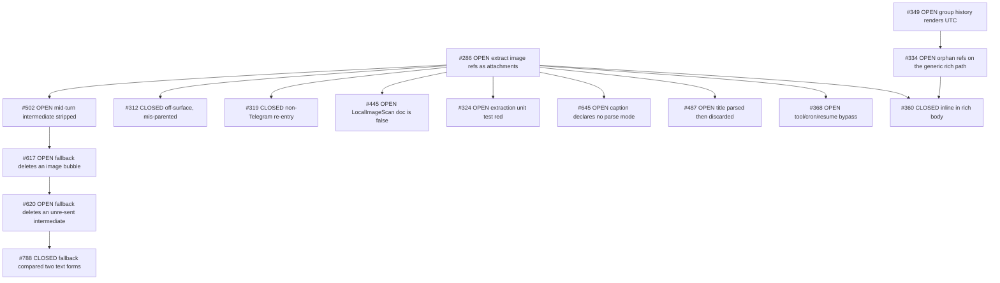
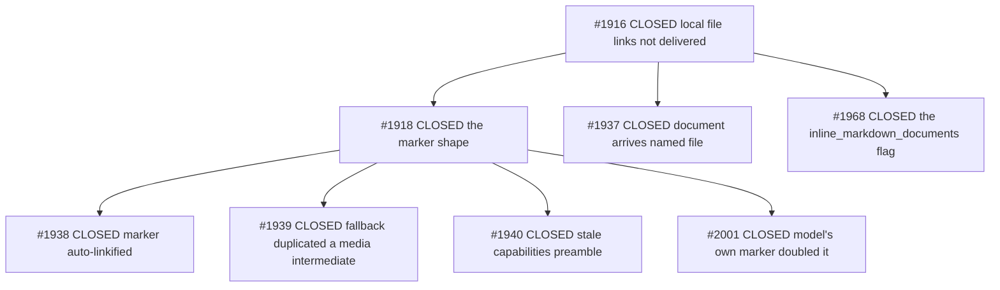

# ADR 0001 — Local file and image delivery on Telegram ("inlining")

- **Status:** Accepted (retrospective — codifies behaviour already in the tree)
- **Date:** 2026-10-29
- **Scope:** `src/utils/image.rs` (the reference walks), `src/channels/telegram/delivery.rs` (both planes),
  `src/channels/telegram/intermediates.rs` (promoted bubbles), `src/channels/telegram/file_links.rs`
  (DM deep links), `src/brain/prompt_builder.rs` (what the model is told)
- **Supersedes:** the `[channels.telegram] inline_markdown_documents` flag (deleted in `ff1425cc5`)
- **Code state:** `bdffd1878` on fork `main`. Shipped binary is `b2dcf5715` — see §9.

## 1. Context

A model writing a reply cannot upload anything. It writes a **reference to a path on the box**, and the
delivery layer decides what the reader receives:

```markdown
Here is the chart:              
Here is the report:             [Full write-up](/tmp/report.md)
```

Telegram gives a bot three ways to put bytes in front of a reader, and they behave very differently:

| Vehicle | What the reader gets | Can it be addressed later? |
|---|---|---|
| `sendPhoto` / `sendDocument` / `sendVideo` | its own message ("bubble"), openable | yes — a message id exists |
| A `media` entry inside `sendRichMessage` | rendered **inside** the message body | no — it is not a message |
| A `tg://<kind>?id=…` link inside a rich body | a link, **if** the media array answers it | no |

The whole history of this area is the discovery of which of those three works for which kind of file.
It was not obvious, and three separate assumptions were measured false (§7).

## 2. Decision

**Two reference families, decided by SYNTAX, not by file extension. Images inline into the rich message
body; every non-image file is delivered as its own detached bubble. Nothing else inlines.**

1. `` — the **image** family. Validated by magic bytes, rewritten in place to
   ``, and its bytes ride the rich message's `media` array. The picture renders
   inside the body, with the markdown title as its caption.
2. `[label](path)` — the **file** family. Never inlined, for any extension. The reference is replaced in
   place by a visible `📎 <label>` marker, and the bytes ship as their own `sendDocument` bubble *before*
   the body.
3. `<>` / `<<VID:path>>` — machine markers, owned by the image / video families respectively.

The discriminator is the **`!`**. `[chart.png](/tmp/chart.png)` and `` name
the same bytes and take different roads: the first arrives as a document bubble, the second renders
inline. This is deliberate — it is the only signal the author gives about intent — and it is the single
most surprising fact in this document.

## 3. The image plane (inline)

Walk order is **video → image → file**, and it is load-bearing: a `` reference fails image
validation (`UnsupportedFormat`), and an image-first walk would consume it and report "Image not attached"
before the video family could claim it. So the video walk runs first, the image walk runs on its output,
and the file walk runs last on the image walk's output — one owner per reference, the same order the text
floor uses.

Per reference:

| Step | Rule |
|---|---|
| Target | local path (absolute, `~`, relative to the session cwd) → claimed. Remote URL or an existing `tg://` ref → left verbatim, never fetched, never deleted (#286's loss mode) |
| Validate | stat + 12-byte header; PNG / JPEG / GIF87a / GIF89a / WEBP / BMP only |
| Dedup | compared on the **resolved absolute** path, so `~/x.png` and `/root/x.png` dedup; an already-delivered picture is consumed and re-sent nothing |
| Rewrite | ``; a caption rides the markdown **title** (`"…"`), because the rich media array has no caption field |
| Caption gate | dropped if it contains `)`, `"` or `\`, or folds to empty — the image still arrives, merely unnamed |
| Oversize | no size gate in the rich walk. The **floor** routes ≤ 10 MiB to `sendPhoto`, above it to `sendDocument` (an un-previewable image beats a missing one) |

Reference ids are namespaced per family (`img` / `vid`) because entries are matched to references **by id
inside one message's media array** — a shared prefix would let an image entry answer a video reference.

## 4. The file plane (detached)

Every resolvable non-image file:

1. leaves the text and is replaced by `📎 <label>` (empty label → the file's own basename);
2. records **no** media entry, so the rich plane never claims it;
3. is shipped by the file floor as one `sendDocument` per file, **before** the body, with no caption (the
   caption would repeat the marker one line down);
4. the marker is then rewritten into a link to that bubble — when the chat has a link form (§6).

Rules that hold on both planes, because a link carries its own label and a silent strip would delete the
reader's only clue:

- a reference inside a code span is never touched (#464 is the open defect where a *marker* inside a
  backtick span still gets extracted);
- an unresolvable reference stays **byte-identical** and is reported to the model as a failure — never
  silently dropped (#768, #793);
- a `📎 ` the model wrote itself is consumed before the harness emits its own, so the marker is never
  doubled (#2001);
- the label is passed through `disarm_autolink`, so `harvest-report.md` does not become a fake domain
  (#1938).

Size ceiling for a document: **50 MiB** (`TELEGRAM_DOCUMENT_MAX_BYTES`), enforced *before* delivery so the
model is told "too large" instead of the channel silently refusing.

## 5. The `.md` file path

**A `.md` file is an ordinary document. It has no carve-out, no flag, and no code path of its own.**

There was one, and it is worth recording why it died, because it is the exact question this ADR exists to
settle:

| Stage | What it did | Verdict |
|---|---|---|
| `#1968` (upstream) | `.md` shipped detached by default because **Telegram Android** opens a `.md` *attachment* in its viewer but cannot open an inlined `PageBlockDocument`. Gated by `[channels.telegram] inline_markdown_documents` (default `false`) | the narrow fix, on the wrong ground |
| `#779` | a `.md` in a promoted intermediate was never delivered at all — the floor only sent files the rich plane had skipped, and a `.md` was never skipped | real bug, fixed |
| `#801` | measured: a `document` media entry is accepted with `ok:true` and **silently dropped** — in link syntax, in image syntax, with an explicit `file_name`. Only `photo` attaches. So the `.md` carve-out was not a special case of a working feature; **no document can inline at all** | the flag, its tests, its `Default` line, its prompt text and its README lines deleted in `ff1425cc5` |

Live confirmation on the shipped binary (DM `oc_l1979_bot`, 2026-10-29): `[spec.md]` → its own bubble,
`text/markdown`, 71 B; `[notes.txt]` → own bubble, `text/plain`, 35 B; `[chart.png]` → own bubble,
`image/png`, 102 119 B. Three bubbles, identical shape, zero inlining — note that the `.png` there is a
*file link*, not an image reference, so it correctly lands as a document (§2).

**There is no configuration key governing inlining today.** `inline_markdown_documents` is absent from
`TelegramConfig` (17 fields) and from all three live configs; `deny_unknown_fields` is not used, so a stale
key in a user's file is inert rather than fatal. The only knobs that touch this area are `rich_messages`
(gates the rich plane at all — off means everything is a detached bubble) and the `mermaid_*` trio.

## 6. DM vs group separation

Inlining itself is **chat-kind independent**: an image inlines in a DM exactly as in a forum topic (both
verified live). What differs is the **link form of the `📎` marker**, because a marker should lead to the
bubble that carries the file:

| Chat | `chat_id` shape | Marker form |
|---|---|---|
| Supergroup / forum topic | starts `-100…` | `https://t.me/c/<internal>/<thread>/<msg_id>` (thread in the middle) |
| Channel | starts `-100…` | `https://t.me/c/<internal>/<msg_id>` |
| **DM** | positive | `https://t.me/<bot_username>?start=file_<token>` — a **deep link**, not a message link |
| Basic group | negative, no `-100` | **plain text** — no addressable form exists |

The DM case is the subtle one. A bot never sees the client's message ids: measured in the DM, a file the
Bot API called `60451` is client message `975269`, and `messages.getHistory` over `60000..=60452` returns
nothing. `1eb7a355c` shipped `t.me/<bot>/<id>` anyway and every DM link it built was dead; it was
withdrawn in `72f21d1c4`.

A deep link sidesteps the id space entirely:

```
📎 spec.md  →  https://t.me/oc_l1979_bot?start=file_<token>
                 ↓ tap
               /start file_<token>
                 ↓
               re-send that document into the chat
```

- token: 12 hex chars of a uuid, collision-checked;
- map: `<home>/telegram_file_links.json`, a plain JSON file — disposable, so a lost map costs one re-send
  request, never a delivery;
- an unwritable map, or a file since removed, yields `None` → the plain marker, never a link that leads
  nowhere;
- the `/start` branch re-checks the allowlist, because `/start` is handled before the normal admission gate
  and a deep link must not be a way around it.

## 7. Rejected alternatives (each one measured, not argued)

| Alternative | Why it failed |
|---|---|
| Inline documents as `{"type":"document"}` media entries | API answers `ok:true` and delivers nothing — no attachment, no error, just a dead link (#801) |
| Reference a document entry in **image** syntax to force attachment | hard `400 RICH_MESSAGE_DOCUMENT_INVALID`; the same shape on a *photo* entry 400s as `RICH_MESSAGE_PHOTO_INVALID` (#800) |
| Reference a document in **link** syntax | inert for **all** media kinds — a photo entry referenced as `[x](tg://photo?…)` does not attach either. The discriminator is the markdown form, not the kind (#801 arm E) |
| A flag to keep `.md` inline | gates a behaviour that cannot work; retired with its tests (§5) |
| Address a DM bubble by `t.me/<bot>/<id>` | the bot's id space is not the client's (#802) |
| Delete a link nothing downstream will fetch | silently loses a file the author believed was delivered (#286) |
| Caption the document bubble with the marker text | the reader reads the same string twice, one line apart (#780) |

## 8. Issue census — everything filed about inlining local files and images

### Source and method (read this before trusting the tables)

The census is an **exhaustive enumeration**, not a recollection. Enumerated in one pass on 2026-10-29:

| Population | Count | Command |
|---|---|---|
| Fork issues (open + closed) | **782** | `gh issue list -R leshchenko1979/opencrabs --state all --limit 2000` |
| Upstream issues (open + closed) | **1760** | `gh issue list -R opencrabs/opencrabs --state all --limit 3000` |
| Fork PRs | **20** | `gh pr list -R leshchenko1979/opencrabs --state all` |
| Upstream PRs | **403** | `gh pr list -R opencrabs/opencrabs --state all` |

Selection was two-stage, because a title regex alone under-counts:

1. **Title regex** over all 2,542 issues — `inlin|attach|local (file|image)|image ref|photo ref|media entr|tg://|📎|file link|file marker|markdown file|detach|own bubble|sendDocument|document bubble|caption` — which returned 40 fork and 74 upstream candidates, then hand-filtered to the rows below.
2. **Body search** with `gh search issues --repo <R>` on `inline_markdown_documents`, `tg://document`, `📎`, `local file attachment`, which is what surfaces an issue whose *title* never names the surface (that is how `#2125` and `#406` were found).

**What the first pass missed, and why** — recorded because it is the reusable lesson: the initial census was assembled from this lane's own session history plus targeted lookups, and it under-counted. Three classes fell through:

- **Ancestors and ordering decisions** filed before the reference-extraction work was named as such — upstream `#406` ("deliver generated attachments before the final response") is the origin of the *attachments-then-body* ordering the ADR §4 depends on, and its title never says "inline".
- **Same surface, different failure** — upstream `#2125` (two attachments resolving to one offset, splice panic) is an attachment-extraction defect, filed under `panic`, invisible to any keyword sweep for inlining.
- **Residuals of a closed shield** — fork `#334` (orphan `tg://photo?id=` / `attach://` refs still 400ing after `#289`) and fork `#645` (media captions ship raw markdown). Both are live defects on the delivery plane and both were absent.

The general lesson, which belongs to this repo's read discipline rather than to this ADR: **a census keyed on the vocabulary of a decision finds the issues filed in that vocabulary, not the issues about that surface.** Enumerate the population, then filter — and check the filter's own blind spot against a body search.

Fork `leshchenko1979/opencrabs` unless marked *upstream* (`opencrabs/opencrabs`). **42 issues**, of which **13 open** (10 on the image plane, 3 on the shields/captions/fallback group). Four rows (`#319`, `#324`, `#445`, upstream `#1937`) were not in the keyword census at all — they were surfaced by the dependency walk in §9, which is the more reliable enumeration: the tracker's own edges, not a vocabulary guess.

**Images (inline plane)**

| # | State | What it settled |
|---|---|---|
| [286](https://github.com/leshchenko1979/opencrabs/issues/286) | OPEN | the origin request: extract markdown image refs as attachments; still open for non-Telegram channels |
| [289](https://github.com/leshchenko1979/opencrabs/issues/289) | CLOSED | shield unresolvable image refs so one bad URL cannot 400 the reply |
| [319](https://github.com/leshchenko1979/opencrabs/issues/319) | CLOSED | post-delivery re-entry when image delivery fails on Slack / Discord / WhatsApp — the image plane outside Telegram |
| [324](https://github.com/leshchenko1979/opencrabs/issues/324) | OPEN | the extraction unit test is **red on `main`**: `image_util_test::non_image_schemes_are_not_remote` expects `Unresolved` for an absolute path |
| [360](https://github.com/leshchenko1979/opencrabs/issues/360) | CLOSED | images render **inline** in the rich body, not as separate attachments |
| [368](https://github.com/leshchenko1979/opencrabs/issues/368) | OPEN | tool/cron/resume sends bypass extraction → dead markdown text |
| [445](https://github.com/leshchenko1979/opencrabs/issues/445) | OPEN | `LocalImageScan.text`'s doc comment claims remote targets are "left untouched" — false on the fetch path |
| [464](https://github.com/leshchenko1979/opencrabs/issues/464) | OPEN | a marker inside a code span is still extracted |
| [465](https://github.com/leshchenko1979/opencrabs/issues/465) | CLOSED | the video family, and the walk order it forced |
| [487](https://github.com/leshchenko1979/opencrabs/issues/487) | OPEN | image title (caption) parsed then discarded on some paths |
| [502](https://github.com/leshchenko1979/opencrabs/issues/502) | OPEN | local image in a mid-turn intermediate stripped, never sent |
| [515](https://github.com/leshchenko1979/opencrabs/issues/515) | OPEN | the svg escape hatch ships two labels |
| [617](https://github.com/leshchenko1979/opencrabs/issues/617) | OPEN | rich-fallback cleanup deletes a bubble that carried an image |
| [731](https://github.com/leshchenko1979/opencrabs/issues/731) | OPEN | a bare `VID` token in prose swallows the rest of the reply |
| [732](https://github.com/leshchenko1979/opencrabs/issues/732) | CLOSED | a clip now inlines in the rich body |

**Files / documents (detached plane)**

| # | State | What it settled |
|---|---|---|
| [768](https://github.com/leshchenko1979/opencrabs/issues/768) | CLOSED | a `file://` target attaches instead of vanishing |
| [771](https://github.com/leshchenko1979/opencrabs/issues/771) | CLOSED | the marker links on a resume-path turn too (chat fact, not message fact) |
| [773](https://github.com/leshchenko1979/opencrabs/issues/773) | CLOSED | marker located by content, not by a stale span |
| [779](https://github.com/leshchenko1979/opencrabs/issues/779) | CLOSED | a `.md` in a promoted intermediate is delivered |
| [780](https://github.com/leshchenko1979/opencrabs/issues/780) | CLOSED | the bubble carries no caption |
| [793](https://github.com/leshchenko1979/opencrabs/issues/793) | CLOSED | a path containing a space parses |
| [800](https://github.com/leshchenko1979/opencrabs/issues/800) | CLOSED | a document entry referenced in image syntax 400s the whole send |
| [801](https://github.com/leshchenko1979/opencrabs/issues/801) | CLOSED | **the decision of this ADR**: no document inlines, ever |
| [802](https://github.com/leshchenko1979/opencrabs/issues/802) | CLOSED | a DM marker gets a deep link (§6) |

**Both planes — shields, captions, fallback (the group the first pass missed)**

| # | State | What it settled |
|---|---|---|
| [334](https://github.com/leshchenko1979/opencrabs/issues/334) | OPEN | `#289`'s shield covers the rich dialect only — orphan `tg://photo?id=` / `attach://` refs still 400 on the generic rich path |
| [620](https://github.com/leshchenko1979/opencrabs/issues/620) | OPEN | the rich fallback deletes intermediates it never re-sent — a file marker inside one is lost silently |
| [645](https://github.com/leshchenko1979/opencrabs/issues/645) | OPEN | a media **caption** declares no parse mode, so markdown in a caption ships literal |
| [788](https://github.com/leshchenko1979/opencrabs/issues/788) | CLOSED | the rich fallback compared two text forms, re-sent the body and deleted nothing |

**Upstream lineage**

| # | State | What it settled |
|---|---|---|
| [#1916](https://github.com/opencrabs/opencrabs/issues/1916) | CLOSED | local file links are not delivered — resolve and send |
| [#1918](https://github.com/opencrabs/opencrabs/issues/1918) | CLOSED | the marker shape, and the `tg://document` inlining this ADR later falsified |
| [#1921](https://github.com/opencrabs/opencrabs/issues/1921) | CLOSED | the shield learned the fourth `tg://` kind |
| [#1937](https://github.com/opencrabs/opencrabs/issues/1937) | CLOSED | a delivered document arrives named `file` — `InputFile::memory` ships no filename, so the bubble's name is not the path's basename |
| [#1938](https://github.com/opencrabs/opencrabs/issues/1938) | CLOSED | marker auto-linkified into a fake domain |
| [#1939](https://github.com/opencrabs/opencrabs/issues/1939) | CLOSED | rich fallback duplicated a media-bearing intermediate |
| [#1940](https://github.com/opencrabs/opencrabs/issues/1940) | CLOSED | the capabilities preamble went stale |
| [#1968](https://github.com/opencrabs/opencrabs/issues/1968) | CLOSED | the `inline_markdown_documents` flag (§5) |
| [#2001](https://github.com/opencrabs/opencrabs/issues/2001) | CLOSED | the model's own `📎` doubled the marker |
| [#406](https://github.com/opencrabs/opencrabs/issues/406) | CLOSED | **the ordering guarantee this ADR's §4 depends on**: attachments ship before the final body, so a turn never ends on a dangling document |
| [#1079](https://github.com/opencrabs/opencrabs/issues/1079) | CLOSED | `send_photo` / `send_document` skipped `resolve_thread_id` — a file could land in General instead of its topic |
| [#933](https://github.com/opencrabs/opencrabs/issues/933) | CLOSED | the compiled `/attach` and `/architecture` commands ([PR #1751](https://github.com/opencrabs/opencrabs/pull/1751)) — a **third** entry point to the detached floor, beside markdown refs and `<>` |
| [#1773](https://github.com/opencrabs/opencrabs/issues/1773) | CLOSED | the compiled preamble now tells the model to attach a report file, not just name its path (§5, prompt side) |
| [#2125](https://github.com/opencrabs/opencrabs/issues/2125) | CLOSED | two refs resolving to one offset spliced twice and panicked — the extraction plane's own crash |

## 9. Dependency graph — the edges, traced on both trackers

The census above is a *flat* list. A flat list cannot tell you which open issue is a child of which
decision, which closed fix still carries a blocker, or which issue is the root the rest hang off. The
tracker already knows; it just has to be read.

**Method.** For all 38 census issues, on both trackers:

```
gh issue view <N> -R <repo> --json number,state,parent,subIssues,blockedBy,blocking
```

38 invocations, 0 failures, 2026-10-29. The four fields cover the 1-hop neighbourhood in **both**
directions — a child appears in its parent's `subIssues`, a blocker in its victim's `blockedBy` — so
no reverse index is needed and no edge touching the census can hide. Pagination checked: `#286`
returns `nodes=9`, `totalCount=9`, so the largest child list here is complete.

**What the walk returned:** the 38 census issues, plus **7 issue numbers the keyword census never saw**.
That is the finding worth carrying: *a dependency walk is a better census than a keyword sweep*, because
it is keyed on what the tracker asserts about a surface rather than on the words a filer happened to use.

### 9.1 The image plane is one tree, not twelve loose issues

`#286` is the hub — 9 direct children, 6 of them open. Everything the image plane still owes hangs off
it, which means a reader who wants "what is left on images" reads one node and its subtree, not a filter.



The `#502 → #617 → #620 → #788` chain is the useful one: four issues, three still open, all describing
the **same** mechanism from different ends — a fallback that deletes a bubble it never re-sent. `#788`
closed one face of it; `#620` is the same defect reached by a different path, and it is filed as
`#617`'s blocker. Reading them separately produces three fixes for one bug.

Two smaller trees carry the rest:

| Root | Children | Shape |
|---|---|---|
| `#465` CLOSED | `#732` CLOSED | the video family, fully closed |
| `#515` OPEN | `#636` OPEN | the svg escape hatch, and its failure block's raw error bodies |
| `#801` CLOSED | `#802` CLOSED | **the decision of this ADR and its DM follow-up** — the one edge this ADR created itself |

Ten fork issues carry no edges at all: `#289`, `#464`, `#731`, `#768`, `#771`, `#773`, `#779`, `#780`,
`#793`, `#800`. `#771` is the exception that proves the point — it is `blockedBy #773`, a pair filed
together and linked correctly; the rest were filed as standalone defects.

### 9.2 Upstream is a closed two-level tree



Eight issues, **all closed**. Nothing upstream is pending on this surface, so there is no upstream work
that this ADR's decision leaves hanging. The other six upstream issues (`#1921`, `#406`, `#1079`, `#933`,
`#1773`, `#2125`) carry no edges — they were filed as standalone defects rather than as children of the
lineage root, which is why the tree above is not the whole upstream census.

`#1937` is the upstream row the keyword census missed, and it is not a footnote: it is *"a delivered
document arrives named `file`"* — the bubble's name is not the path's basename, because `InputFile::memory`
ships no filename. That is precisely the property the owner asked for by name ("a correct file name"),
so a census of this surface that omits it is missing a requirement, not a detail.

### 9.3 The seven the census missed

| # | State | Surface verdict |
|---|---|---|
| fork [319](https://github.com/leshchenko1979/opencrabs/issues/319) | CLOSED | **on surface** — the image plane on Slack / Discord / WhatsApp |
| fork [324](https://github.com/leshchenko1979/opencrabs/issues/324) | OPEN | **on surface, and red** — an extraction unit test failing on `main` |
| fork [445](https://github.com/leshchenko1979/opencrabs/issues/445) | OPEN | **on surface** — `LocalImageScan.text`'s doc contradicts the fetch path |
| upstream [1937](https://github.com/opencrabs/opencrabs/issues/1937) | CLOSED | **on surface** — the delivered filename |
| fork [636](https://github.com/leshchenko1979/opencrabs/issues/636) | OPEN | **adjacent** — the mermaid failure block ships raw HTTP error bodies; rich plane, not the file plane |
| fork [312](https://github.com/leshchenko1979/opencrabs/issues/312) | CLOSED | **off surface** — `oc-issue-dispatch` tooling, parented under `#286` anyway |
| fork [349](https://github.com/leshchenko1979/opencrabs/issues/349) | OPEN | **off surface** — group history renders raw UTC; it appears only as a blocker, see §9.4 |

`#324` deserves its own sentence: the census is documentation, but that row says the extraction plane has
a **failing test on `main` right now**. Either the test's expectation or the resolver is wrong, and nothing
in this ADR depends on which — but a reader of this document should know the plane is not green.

### 9.4 Two edges that are wrong

Both are tracker hygiene, not code defects, and both actively mislead:

| Edge | Problem |
|---|---|
| `#360` is **CLOSED** yet still lists `#334` (**OPEN**) as its blocker | a closed issue cannot be blocked by anything. The edge was never cleared when `#360` landed |
| `#334` **OPEN** is `blockedBy #349` **OPEN** — *"group history block renders raw UTC"* | a timezone-rendering fix cannot block a media-ref shield. Nothing in `#349` touches `#334`'s path |

The second is the one that costs something: a reader — or a dispatch tool — that trusts the graph reads
`#334` as blocked, and `#334` is the highest-severity open item here (an orphan ref still 400s a whole
reply). **It is not blocked.** Its remedy is local to the rich path.

### 9.5 What the graph changes about this ADR

Nothing in the decision, and three things in the reading:

1. **The open work is 13 issues, not a scattered 11** — 10 under the `#286` image tree, 3 in the
   shields/captions/fallback group. Not one of the 13 contradicts §4–§6; every one is a path where a
   reference is lost, mis-owned or mis-rendered. The decision is stable under its own backlog.
2. **`#801`'s subtree is closed and shipped** — the decision and its DM follow-up are both CLOSED, and
   the only part of that pair not on the running binary is the deep link (§10, item 1).
3. **The census method was the weak leg, twice.** First pass: 29 issues, missing ancestors and residuals.
   Second pass: 38, missing everything the tracker links but no title names. The graph found 7 more in one
   command per issue. Enumerate the population, then read the tracker's own edges — then filter by words
   only to catch what was filed before any edge existed.

## 10. Consequences and open items

**Standing cost of the decision:** a reader cannot tap an inline document, because there is no such thing.
The floor always produces a real bubble, so the affordance is the bubble plus a link that resolves to it.

**Open, in order of what a reader would notice:**

1. **The DM deep link is not shipped.** `21d72dd9b` (plus changelog `bdffd1878`) is committed on `main`
   but `deployed.sha` is `b2dcf5715`, so a DM marker is still plain text on the running binary. Shipping
   it is a choice: tapping the marker then appends `/start file_<token>` to the chat and re-sends the file.
2. A plain-text marker in a **basic group** cannot be made tappable — no link form exists.
3. The token map grows by one entry per distinct path and is never pruned.
4. **Ten open on the image plane** — #286, #324, #368, #445, #464, #487, #502, #515, #617, #731. Each is a path where
   a reference is lost, mis-owned or mis-rendered; none disagrees with this ADR. **#324 is a failing test on
   `main`**, not a feature gap (§9.3).
5. **Three open on the shields/captions/fallback group** — #334 (the `#289` shield never reached the generic
   rich path, so an orphan ref can still 400 a whole reply), #620 (the rich fallback deletes an intermediate
   it never re-sent, taking any marker inside it), #645 (a caption declares no parse mode, so markdown in a
   caption ships literal). These are the residuals of fixes this ADR's decision depends on, which is exactly
   why they were the group the first census pass missed.
6. **Two tracker edges are wrong** (§9.4): `#360` is CLOSED yet still carries a blocker, and `#334` — the
   highest-severity open item here — reads as blocked by `#349`, a timezone fix that touches none of its
   path. Neither is a code defect; both make the tracker lie about what is actually blocked.

## 11. Verification

| Claim | Instrument |
|---|---|
| no document inlines, every extension | `every_file_the_rich_plane_cannot_take_still_has_a_delivery_leg` (`src/tests/telegram_file_delivery_test.rs`) — asserts marker emitted, `rich.entries.is_empty()`, body carries the marker, body carries no `tg://` |
| link form per chat kind | `a_supergroup_bubble_links_by_internal_id` · `a_topic_bubble_links_with_the_topic_in_the_middle` · `a_channel_links_by_the_same_rule_as_a_supergroup` · `a_dm_links_by_deep_link_and_a_basic_group_gets_none` |
| a file that cannot be linked keeps the plain marker | `a_dm_or_an_unsent_file_keeps_the_plain_marker` |
| one bubble per file, in order, no caption | `each_link_ships_its_own_bubble_in_order` · `a_resolved_link_ships_exactly_one_document_with_no_caption` |
| images inline, kind by bytes | `src/tests/telegram_local_image_media_test.rs`, `src/tests/telegram_rich_media_kind_test.rs` |
| behaviour on the shipped binary | DM probe 2026-10-29: `.md` / `.txt` / `.png` as three identical document bubbles, three `📎` markers, zero inlining |
| dependency edges, both trackers | 38 × `gh issue view <N> -R <repo> --json parent,subIssues,blockedBy,blocking`, **0 failures**; `#286` returns `nodes=9` == `totalCount=9`, so the largest child list is untruncated |
