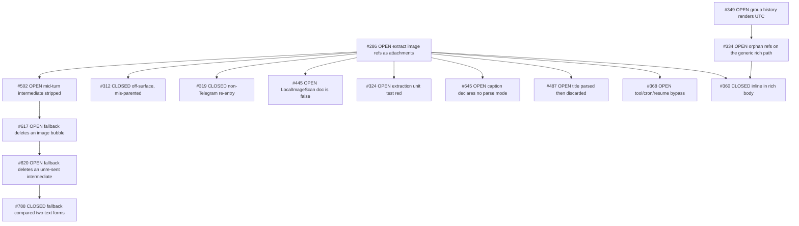
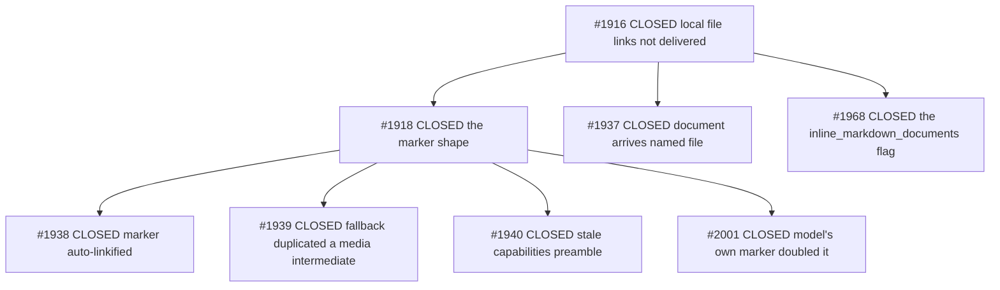

# ADR 0001 — Local file and image delivery on Telegram ("inlining")

- **Status:** Accepted — this is the **intended** behaviour (owner ruling 2026-10-29). The tree does not
  fully implement it yet; §10 lists every gap between this document and the code, so a reader never has to
  guess which half is real.
- **Date:** 2026-10-29 (revision 2 — §2, §4, §5, §6 and §7 rewritten to the owner's ruling)
- **Scope:** `src/utils/image.rs` (the reference walks), `src/channels/telegram/delivery.rs` (every plane),
  `src/channels/telegram/intermediates.rs` (promoted bubbles), `src/channels/telegram/rich/` (media array and
  the reference normalizer), `src/config/types.rs` (`TelegramConfig`), `src/brain/prompt_builder.rs` (what
  the model is told)
- **Supersedes:** `ff1425cc5`'s **blanket** retirement of `inline_markdown_documents` — the flag returns,
  because the ruling makes it the one deliberate exception to inlining (§5). The DM deep link
  (`21d72dd9b`) is reverted in `642724791` and recorded as a rejected alternative (§7).
- **Code state:** `642724791` on fork `main`. Shipped binary is `b2dcf5715` — see §10.

## 1. Context

A model writing a reply cannot upload anything. It writes a **reference to a path on the box**, and the
delivery layer decides what the reader receives:

```markdown
Here is the chart:              
Here is the report:             [Full write-up](/tmp/report.md)
```

Telegram gives a bot three ways to put bytes in front of a reader, and they behave very differently:

| Vehicle | What the reader gets | Can it be addressed later? |
|---|---|---|
| `sendPhoto` / `sendDocument` / `sendVideo` | its own message ("bubble"), openable | yes — a message id exists |
| A `media` entry inside `sendRichMessage` | rendered **inside** the message body | no — it is not a message |
| A `tg://<kind>?id=…` link inside a rich body | a link, **if** the media array answers it | no |

The whole history of this area is the discovery of which of those three works for which kind of file.
It was not obvious, and three separate assumptions were measured false (§7).

## 2. Decision

**Everything the author references inlines into the rich message body. What decides is the KIND of the
bytes on disk — not the syntax the reference is written in.** The rich path is the default plane. The
detached bubble is what remains when there is no rich path at all, or when the `.md` toggle deliberately
keeps a markdown document out of it.

| # | Rule | Plane |
|---|---|---|
| 1 | A resolvable local reference to an **image** (PNG / JPEG / GIF87a / GIF89a / WEBP / BMP, by magic bytes) renders inline; its bytes ride the rich message's `media` array as a `photo` entry | rich |
| 2 | A resolvable local reference to a **video** renders inline as a `video` entry | rich — **not confirmed live** (§3.2) |
| 3 | A resolvable local reference to **any other file** — one document kind, every extension — renders inline as a `document` entry | rich — **measured impossible so far** (§4) |
| 4 | `.md` / `.markdown`, **when `inline_markdown_documents = true`**, are the deliberate exception: they leave the rich body and ship detached | rich path, forced out |
| 5 | With **no rich path** — `rich_messages = false`, or a rich send that failed and fell back — every kind ships as its own detached bubble | non-rich |

Three consequences worth stating plainly, because each one used to be the opposite rule:

- **The `!` decides nothing.** `[chart.png](/tmp/chart.png)` and `` name the
  same bytes and take the **same** road: both inline. The reference's label (and, for the image form, its
  `"…"` title) is the caption; the syntax is not a routing signal. A `.png` written as a plain link is
  still a picture, and the old behaviour — an un-previewable document bubble for the same file the image
  form renders inline — was an accident of how the author typed it.
- **The floor never disappears.** Every kind still has a detached leg, and it stays *ungated*: it is what
  carries the bytes when the rich plane declines, fails, or is switched off. An inline entry is an
  *additional* delivery, never a replacement for a bubble that a client can open.
- **The rich body is written only if the array answers it.** A `tg://photo` / `tg://video` /
  `tg://document` reference in the body that no media entry resolves renders as dead markdown. This is why
  the reference rewrite and the entry push are one operation and never two (§3.3).

Rule 3 is the ruling's substance and the tree cannot do it yet: the intent is recorded here, the measured
limit is in §4, and the shape that has not been tried is named there as the probe that would close the gap.

Rules 1–3 share one walk order — **video → image → file** — because each family must own a reference
exactly once (§3.1). That ordering is unchanged by this decision; what changes is that a family's
*rejection* no longer implies "detach", only "the next family may claim it".

## 3. The inline planes (image, video, document)

### 3.1 Walk order — one owner per reference

**video → image → file**, and the order is load-bearing. A `` reference fails image
validation (`UnsupportedFormat`); an image-first walk would consume it and report "Image not attached"
before the video family could claim it. So each walk runs on the text its predecessor left behind, and a
reference is claimed exactly once — the same one-owner invariant the text floor uses.

Under this ADR the order keeps its meaning but loses one inference: a family that *declines* a reference
does not decide the reference is detached. It hands the reference to the next family, and the last family
(the document one) decides. That is the difference between "the image walk saw a `.md` and detached it" —
today's tree — and "the image walk saw a `.md`, declined, and the document walk inlined it".

### 3.2 Images and videos

| Step | Rule |
|---|---|
| Target | local path (absolute, `~`, relative to the session cwd) → claimed. Remote URL or an existing `tg://` ref → left verbatim, never fetched, never deleted (#286's loss mode) |
| Validate | stat + 12-byte header; PNG / JPEG / GIF87a / GIF89a / WEBP / BMP only (video: mp4 / m4v / mov / webm / mkv / avi / 3gp / flv) |
| Dedup | compared on the **resolved absolute** path, so `~/x.png` and `/root/x.png` dedup; an already-delivered picture is consumed and re-sent nothing |
| Rewrite | `` / ``; a caption rides the markdown **title** (`"…"`), because the rich media array has no caption field |
| Caption gate | dropped if it contains `)`, `"` or `\`, or folds to empty — the media still arrives, merely unnamed |
| Oversize | no size gate in the rich walk. The **floor** routes images ≤ 10 MiB to `sendPhoto`, above it to `sendDocument` (an un-previewable image beats a missing one) |

Reference ids are namespaced per family (`img` / `vid`, and `doc` for the document family this ADR adds)
because entries are matched to references **by id inside one message's media array** — a shared prefix
would let an image entry answer a video reference.

**One measurement is outstanding on this plane and it is not cosmetic.** `ff1425cc5`'s comment at
`src/utils/image.rs:2270` records that in #801's five multipart probes a `video` media entry "behaved the
same way" as a document entry — accepted, then dropped — and that "only `photo` attached". The video plane
ships a `video` entry regardless (`rich/table.rs`, `telegram_rich_media_kind_test.rs`,
`telegram_video_intermediate_test.rs` all assert it), so one of the two is wrong. The tree has not
measured a clip rendering inline inside a rich body since that probe. Until it is re-measured, rule 2 of
§2 is **intended behaviour, not verified behaviour**, and a video must keep its detached floor leg.

### 3.3 The body is written only if the array answers it

A `tg://photo` / `tg://video` / `tg://document` reference whose media entry is missing or of a different
kind renders as **dead visible markdown**. Two rules follow, and both are already enforced in the tree:

- the reference rewrite and the entry push happen in the **same** operation, from the same resolved
  value — never two passes that could disagree about which references were claimed;
- the media-array builder **demotes** a reference it cannot satisfy: image syntax aimed at a non-photo
  entry is rewritten to link syntax rather than sent as a 400 (`rich/table.rs`). A demoted reference is
  inert but readable; a wrong one fails the whole message.

## 4. The document plane — the gap between intent and measurement

**Intent (§2 rule 3): every non-image, non-video file inlines as a `document` media entry, in the same
message, whatever its extension.**

**Measured reality: no document entry has ever attached.** #801's five multipart `sendRichMessage` probes
(2026-10-28) tried a `{"type":"document"}` entry in link syntax, in image syntax, and with an explicit
`file_name`; every one answered `ok:true` and delivered nothing. Image syntax aimed at a document entry is
worse — a hard `400 RICH_MESSAGE_DOCUMENT_INVALID`. #1918's `tg://document?id=docN` reference therefore
always rendered as a clickable dead link, which is the owner report that started this.

**The untried shape.** Photos attach because their bytes are uploaded as a multipart part and referenced
as `attach://<name>`. Every document probe used a URL or a bare entry; none referenced a **multipart part
in link syntax**, i.e. `[name](attach://doc0)` with the bytes in the same multipart body. That is the one
asymmetry between the working photo path and the failing document path, so it is the next probe, and it is
a **probe before it is a design**: if it fails, rule 3 stays intent and the detached floor is the
permanent answer for documents; if it works, the document family gains the same three pieces the image
family has (a `doc` id namespace, a rewrite, an entry) and §2 rule 3 becomes real.

**Until then, in the tree:** every resolvable document leaves the body as `📎 <label>` (empty label → the
file's own basename), records no media entry, and ships as one `sendDocument` per file **before** the body,
with no caption (the caption would repeat the marker one line down). The marker is then rewritten into a
link to that bubble when the chat has a link form (§6). This is the leg that must survive whatever the
probe finds: it is what carries a file when the rich plane declines, fails, or is switched off.

Rules that hold on every plane, because a link carries its own label and a silent strip would delete the
reader's only clue:

- a reference inside a code span is never touched (#464 is the open defect where a *marker* inside a
  backtick span still gets extracted);
- an unresolvable reference stays **byte-identical** and is reported to the model as a failure — never
  silently dropped (#768, #793);
- a `📎 ` the model wrote itself is consumed before the harness emits its own, so the marker is never
  doubled (#2001);
- the label is passed through `disarm_autolink`, so `harvest-report.md` does not become a fake domain
  (#1938).

Size ceiling for a document: **50 MiB** (`TELEGRAM_DOCUMENT_MAX_BYTES`), enforced *before* delivery so the
model is told "too large" instead of the channel silently refusing.

## 5. The `.md` path — the one deliberate exception

**A `.md` file inlines like every other document, unless `[channels.telegram] inline_markdown_documents` is
`true` — then it is forced out of the rich path and ships detached.**

The flag is the *reason* this ADR needed a ruling. It was introduced by `#1968` with the opposite
polarity (`true` = inline), deleted outright by `#801`, and now returns under the owner's rule: **md
detaches when the toggle is set**. Name and polarity are kept from `#1968` so the default (`false`)
reproduces today's behaviour and no config migrates — with `false`, md is just another document and inlines
with the rest; with `true`, md alone is held back.

| Stage | What it did | Verdict |
|---|---|---|
| `#1968` (upstream) | `.md` shipped detached by default because **Telegram Android** opens a `.md` *attachment* in its viewer but cannot open an inlined `PageBlockDocument`. Gated by `inline_markdown_documents` (default `false`) | right exception, wrong default: it detached md on every install |
| `#779` | a `.md` in a promoted intermediate was never delivered at all — the floor only sent files the rich plane had skipped, and a `.md` was never skipped | real bug, fixed |
| `#801` | measured: a `document` media entry is accepted with `ok:true` and **silently dropped** — in link syntax, in image syntax, with an explicit `file_name`. Only `photo` attached | correct measurement, over-broad remedy: it deleted the flag *and* generalised "no document inlines" |
| this ADR | the flag returns with its original polarity; the exception it encodes is real (a client that will not open an inline document should get an attachment), but it is an **exception**, not the rule | the flag is a no-op while §4's gap is open — it can only ever detach what was already detached — and becomes load-bearing the moment a document inlines |

**The toggle's semantics, stated once so the code has one source:** `false` (default) → md is an ordinary
document, inlined like every other file when the document plane works, detached otherwise. `true` → md is
excluded from the document family's inline arm and always takes the detached floor, in every chat kind
(the exception is about the client's viewer, not about DMs). It never affects images or videos.

Live baseline on the shipped binary (DM `oc_l1979_bot`, 2026-10-29, before the flag existed): `[spec.md]` →
its own bubble, `text/markdown`, 71 B; `[notes.txt]` → own bubble, `text/plain`, 35 B;
`[chart.png]` → own bubble, `image/png`, 102 119 B. Three bubbles, identical shape, zero inlining — note
the `.png` there is a *file link*, not an image reference, which under §2 now inlines and under the
shipped binary cannot.

**Configuration surface:** `rich_messages` gates the rich plane at all (off → everything is a detached
bubble, §2 rule 5); `inline_markdown_documents` is the md exception; the `mermaid_*` trio is unrelated.
`deny_unknown_fields` is not used in `src/config/`, so a stale or restored key in a user's file is inert
rather than fatal.

## 6. DM vs group separation

**Inlining is chat-kind independent.** An image inlines in a DM exactly as in a forum topic (both verified
live), and a document will inline in a DM the moment it inlines anywhere — nothing in the rich path reads
the chat kind. A DM is not a second code path for *delivery*; it is a different question only for the
**link form of the `📎` marker**, and even there the answer is now mostly "none".

| Chat | `chat_id` shape | Marker form |
|---|---|---|
| Supergroup / forum topic | starts `-100…` | `https://t.me/c/<internal>/<thread>/<msg_id>` (thread in the middle) |
| Channel | starts `-100…` | `https://t.me/c/<internal>/<msg_id>` |
| **DM** | positive | **plain text** — no message link is reachable from a bot |
| Basic group | negative, no `-100` | **plain text** — no addressable form exists |

**No deep link. A marker is a label, not a transport** (owner ruling 2026-10-29). The bubble is already in
the chat — the floor put it there, and it is tappable as a bubble. The marker's job is to name *which* file
arrived, at the point in the prose where the author referred to it. A `?start=file_<token>` link that
re-sends the document turns a caption into a delivery mechanism: a token registry, a JSON map under the
home, a `/start` branch that runs before the admission gate and has to re-check the allowlist, and a
growth-forever map — all to reach a file that is one bubble above the text.

That is `21d72dd9b`, reverted in `642724791`, recorded in §7 as an alternative that was built and then
rejected on design grounds rather than on a measurement.

**Why a DM cannot have a message link**, which is the only non-obvious fact left here: a bot never sees the
client's message ids. Measured in the DM, a file the Bot API called `60451` is client message `975269`, and
`messages.getHistory` over `60000..=60452` returns nothing. `1eb7a355c` shipped `t.me/<bot>/<id>` anyway and
every DM link it built was dead; it was withdrawn in `72f21d1c4`. A DM and a basic group therefore land on
the same answer by different routes: no addressable form exists, so the marker stays plain.

## 7. Rejected alternatives (each one measured, not argued)

| Alternative | Why it failed |
|---|---|
| Inline documents as `{"type":"document"}` media entries | API answers `ok:true` and delivers nothing — no attachment, no error, just a dead link (#801). **The one shape never tried is `attach://` link syntax — §4, and it is a probe, not a rejection** |
| Reference a document entry in **image** syntax to force attachment | hard `400 RICH_MESSAGE_DOCUMENT_INVALID`; the same shape on a *photo* entry 400s as `RICH_MESSAGE_PHOTO_INVALID` (#800) |
| Reference a document in **link** syntax | inert for **all** media kinds — a photo entry referenced as `[x](tg://photo?…)` does not attach either. The discriminator is the markdown form, not the kind (#801 arm E) |
| Delete `inline_markdown_documents` because no document can inline | the measurement was right, the remedy was too broad: it deleted the one exception the owner wants, on the ground that the rule it excepted was broken. A flag for a broken behaviour is dead weight only until the behaviour works (§5) |
| Address a DM bubble by `t.me/<bot>/<id>` | the bot's id space is not the client's (#802) |
| **A DM deep link that re-sends the file** (`21d72dd9b`, reverted) | **overengineering, owner ruling.** It works, and it is the wrong idea: a marker names a file, the bubble already carries it. The cost was a token registry, a home-dir JSON map, and a `/start` branch ahead of the admission gate — a delivery transport grafted onto a caption |
| Delete a link nothing downstream will fetch | silently loses a file the author believed was delivered (#286) |
| Caption the document bubble with the marker text | the reader reads the same string twice, one line apart (#780) |
| Let the `!` decide inline vs detached | the same bytes arrived two different ways depending on how the author typed the reference, so a `.png` written as `[x](…)` got an un-previewable document bubble. The kind decides (§2) |

## 8. Issue census — everything filed about inlining local files and images

### Source and method (read this before trusting the tables)

The census is an **exhaustive enumeration**, not a recollection. Enumerated in one pass on 2026-10-29:

| Population | Count | Command |
|---|---|---|
| Fork issues (open + closed) | **782** | `gh issue list -R leshchenko1979/opencrabs --state all --limit 2000` |
| Upstream issues (open + closed) | **1760** | `gh issue list -R opencrabs/opencrabs --state all --limit 3000` |
| Fork PRs | **20** | `gh pr list -R leshchenko1979/opencrabs --state all` |
| Upstream PRs | **403** | `gh pr list -R opencrabs/opencrabs --state all` |

Selection was two-stage, because a title regex alone under-counts:

1. **Title regex** over all 2,542 issues — `inlin|attach|local (file|image)|image ref|photo ref|media entr|tg://|📎|file link|file marker|markdown file|detach|own bubble|sendDocument|document bubble|caption` — which returned 40 fork and 74 upstream candidates, then hand-filtered to the rows below.
2. **Body search** with `gh search issues --repo <R>` on `inline_markdown_documents`, `tg://document`, `📎`, `local file attachment`, which is what surfaces an issue whose *title* never names the surface (that is how `#2125` and `#406` were found).

**What the first pass missed, and why** — recorded because it is the reusable lesson: the initial census was assembled from this lane's own session history plus targeted lookups, and it under-counted. Three classes fell through:

- **Ancestors and ordering decisions** filed before the reference-extraction work was named as such — upstream `#406` ("deliver generated attachments before the final response") is the origin of the *attachments-then-body* ordering the ADR §4 depends on, and its title never says "inline".
- **Same surface, different failure** — upstream `#2125` (two attachments resolving to one offset, splice panic) is an attachment-extraction defect, filed under `panic`, invisible to any keyword sweep for inlining.
- **Residuals of a closed shield** — fork `#334` (orphan `tg://photo?id=` / `attach://` refs still 400ing after `#289`) and fork `#645` (media captions ship raw markdown). Both are live defects on the delivery plane and both were absent.

The general lesson, which belongs to this repo's read discipline rather than to this ADR: **a census keyed on the vocabulary of a decision finds the issues filed in that vocabulary, not the issues about that surface.** Enumerate the population, then filter — and check the filter's own blind spot against a body search.

Fork `leshchenko1979/opencrabs` unless marked *upstream* (`opencrabs/opencrabs`). **42 issues**, of which **13 open** (10 on the image plane, 3 on the shields/captions/fallback group). Four rows (`#319`, `#324`, `#445`, upstream `#1937`) were not in the keyword census at all — they were surfaced by the dependency walk in §9, which is the more reliable enumeration: the tracker's own edges, not a vocabulary guess.

**Images (inline plane)**

| # | State | What it settled |
|---|---|---|
| [286](https://github.com/leshchenko1979/opencrabs/issues/286) | OPEN | the origin request: extract markdown image refs as attachments; still open for non-Telegram channels |
| [289](https://github.com/leshchenko1979/opencrabs/issues/289) | CLOSED | shield unresolvable image refs so one bad URL cannot 400 the reply |
| [319](https://github.com/leshchenko1979/opencrabs/issues/319) | CLOSED | post-delivery re-entry when image delivery fails on Slack / Discord / WhatsApp — the image plane outside Telegram |
| [324](https://github.com/leshchenko1979/opencrabs/issues/324) | OPEN | the extraction unit test is **red on `main`**: `image_util_test::non_image_schemes_are_not_remote` expects `Unresolved` for an absolute path |
| [360](https://github.com/leshchenko1979/opencrabs/issues/360) | CLOSED | images render **inline** in the rich body, not as separate attachments |
| [368](https://github.com/leshchenko1979/opencrabs/issues/368) | OPEN | tool/cron/resume sends bypass extraction → dead markdown text |
| [445](https://github.com/leshchenko1979/opencrabs/issues/445) | OPEN | `LocalImageScan.text`'s doc comment claims remote targets are "left untouched" — false on the fetch path |
| [464](https://github.com/leshchenko1979/opencrabs/issues/464) | OPEN | a marker inside a code span is still extracted |
| [465](https://github.com/leshchenko1979/opencrabs/issues/465) | CLOSED | the video family, and the walk order it forced |
| [487](https://github.com/leshchenko1979/opencrabs/issues/487) | OPEN | image title (caption) parsed then discarded on some paths |
| [502](https://github.com/leshchenko1979/opencrabs/issues/502) | OPEN | local image in a mid-turn intermediate stripped, never sent |
| [515](https://github.com/leshchenko1979/opencrabs/issues/515) | OPEN | the svg escape hatch ships two labels |
| [617](https://github.com/leshchenko1979/opencrabs/issues/617) | OPEN | rich-fallback cleanup deletes a bubble that carried an image |
| [731](https://github.com/leshchenko1979/opencrabs/issues/731) | OPEN | a bare `VID` token in prose swallows the rest of the reply |
| [732](https://github.com/leshchenko1979/opencrabs/issues/732) | CLOSED | a clip now inlines in the rich body |

**Documents (inline plane by intent, detached floor today)**

| # | State | What it settled |
|---|---|---|
| [768](https://github.com/leshchenko1979/opencrabs/issues/768) | CLOSED | a `file://` target attaches instead of vanishing |
| [771](https://github.com/leshchenko1979/opencrabs/issues/771) | CLOSED | the marker links on a resume-path turn too (chat fact, not message fact) |
| [773](https://github.com/leshchenko1979/opencrabs/issues/773) | CLOSED | marker located by content, not by a stale span |
| [779](https://github.com/leshchenko1979/opencrabs/issues/779) | CLOSED | a `.md` in a promoted intermediate is delivered |
| [780](https://github.com/leshchenko1979/opencrabs/issues/780) | CLOSED | the bubble carries no caption |
| [793](https://github.com/leshchenko1979/opencrabs/issues/793) | CLOSED | a path containing a space parses |
| [800](https://github.com/leshchenko1979/opencrabs/issues/800) | CLOSED | a document entry referenced in image syntax 400s the whole send |
| [801](https://github.com/leshchenko1979/opencrabs/issues/801) | CLOSED | measured that **no document entry attaches**, and over-reached by retiring the md flag with it — the measurement stands, the blanket remedy is undone by §5 |
| [802](https://github.com/leshchenko1979/opencrabs/issues/802) | CLOSED | a DM marker's link form: the message-id form is impossible, the deep link that replaced it is reverted as overengineering (§6, §7) |

**Both planes — shields, captions, fallback (the group the first pass missed)**

| # | State | What it settled |
|---|---|---|
| [334](https://github.com/leshchenko1979/opencrabs/issues/334) | OPEN | `#289`'s shield covers the rich dialect only — orphan `tg://photo?id=` / `attach://` refs still 400 on the generic rich path |
| [620](https://github.com/leshchenko1979/opencrabs/issues/620) | OPEN | the rich fallback deletes intermediates it never re-sent — a file marker inside one is lost silently |
| [645](https://github.com/leshchenko1979/opencrabs/issues/645) | OPEN | a media **caption** declares no parse mode, so markdown in a caption ships literal |
| [788](https://github.com/leshchenko1979/opencrabs/issues/788) | CLOSED | the rich fallback compared two text forms, re-sent the body and deleted nothing |

**Upstream lineage**

| # | State | What it settled |
|---|---|---|
| [#1916](https://github.com/opencrabs/opencrabs/issues/1916) | CLOSED | local file links are not delivered — resolve and send |
| [#1918](https://github.com/opencrabs/opencrabs/issues/1918) | CLOSED | the marker shape, and the `tg://document` inlining this ADR later falsified |
| [#1921](https://github.com/opencrabs/opencrabs/issues/1921) | CLOSED | the shield learned the fourth `tg://` kind |
| [#1937](https://github.com/opencrabs/opencrabs/issues/1937) | CLOSED | a delivered document arrives named `file` — `InputFile::memory` ships no filename, so the bubble's name is not the path's basename |
| [#1938](https://github.com/opencrabs/opencrabs/issues/1938) | CLOSED | marker auto-linkified into a fake domain |
| [#1939](https://github.com/opencrabs/opencrabs/issues/1939) | CLOSED | rich fallback duplicated a media-bearing intermediate |
| [#1940](https://github.com/opencrabs/opencrabs/issues/1940) | CLOSED | the capabilities preamble went stale |
| [#1968](https://github.com/opencrabs/opencrabs/issues/1968) | CLOSED | the `inline_markdown_documents` flag (§5) |
| [#2001](https://github.com/opencrabs/opencrabs/issues/2001) | CLOSED | the model's own `📎` doubled the marker |
| [#406](https://github.com/opencrabs/opencrabs/issues/406) | CLOSED | **the ordering guarantee this ADR's §4 depends on**: attachments ship before the final body, so a turn never ends on a dangling document |
| [#1079](https://github.com/opencrabs/opencrabs/issues/1079) | CLOSED | `send_photo` / `send_document` skipped `resolve_thread_id` — a file could land in General instead of its topic |
| [#933](https://github.com/opencrabs/opencrabs/issues/933) | CLOSED | the compiled `/attach` and `/architecture` commands ([PR #1751](https://github.com/opencrabs/opencrabs/pull/1751)) — a **third** entry point to the detached floor, beside markdown refs and `<>` |
| [#1773](https://github.com/opencrabs/opencrabs/issues/1773) | CLOSED | the compiled preamble now tells the model to attach a report file, not just name its path (§5, prompt side) |
| [#2125](https://github.com/opencrabs/opencrabs/issues/2125) | CLOSED | two refs resolving to one offset spliced twice and panicked — the extraction plane's own crash |

## 9. Dependency graph — the edges, traced on both trackers

The census above is a *flat* list. A flat list cannot tell you which open issue is a child of which
decision, which closed fix still carries a blocker, or which issue is the root the rest hang off. The
tracker already knows; it just has to be read.

**Method.** For all 38 census issues, on both trackers:

```
gh issue view <N> -R <repo> --json number,state,parent,subIssues,blockedBy,blocking
```

38 invocations, 0 failures, 2026-10-29. The four fields cover the 1-hop neighbourhood in **both**
directions — a child appears in its parent's `subIssues`, a blocker in its victim's `blockedBy` — so
no reverse index is needed and no edge touching the census can hide. Pagination checked: `#286`
returns `nodes=9`, `totalCount=9`, so the largest child list here is complete.

**What the walk returned:** the 38 census issues, plus **7 issue numbers the keyword census never saw**.
That is the finding worth carrying: *a dependency walk is a better census than a keyword sweep*, because
it is keyed on what the tracker asserts about a surface rather than on the words a filer happened to use.

### 9.1 The image plane is one tree, not twelve loose issues

`#286` is the hub — 9 direct children, 6 of them open. Everything the image plane still owes hangs off
it, which means a reader who wants "what is left on images" reads one node and its subtree, not a filter.



The `#502 → #617 → #620 → #788` chain is the useful one: four issues, three still open, all describing
the **same** mechanism from different ends — a fallback that deletes a bubble it never re-sent. `#788`
closed one face of it; `#620` is the same defect reached by a different path, and it is filed as
`#617`'s blocker. Reading them separately produces three fixes for one bug.

Two smaller trees carry the rest:

| Root | Children | Shape |
|---|---|---|
| `#465` CLOSED | `#732` CLOSED | the video family, fully closed |
| `#515` OPEN | `#636` OPEN | the svg escape hatch, and its failure block's raw error bodies |
| `#801` CLOSED | `#802` CLOSED | **the decision of this ADR and its DM follow-up** — the one edge this ADR created itself |

Ten fork issues carry no edges at all: `#289`, `#464`, `#731`, `#768`, `#771`, `#773`, `#779`, `#780`,
`#793`, `#800`. `#771` is the exception that proves the point — it is `blockedBy #773`, a pair filed
together and linked correctly; the rest were filed as standalone defects.

### 9.2 Upstream is a closed two-level tree



Eight issues, **all closed**. Nothing upstream is pending on this surface, so there is no upstream work
that this ADR's decision leaves hanging. The other six upstream issues (`#1921`, `#406`, `#1079`, `#933`,
`#1773`, `#2125`) carry no edges — they were filed as standalone defects rather than as children of the
lineage root, which is why the tree above is not the whole upstream census.

`#1937` is the upstream row the keyword census missed, and it is not a footnote: it is *"a delivered
document arrives named `file`"* — the bubble's name is not the path's basename, because `InputFile::memory`
ships no filename. That is precisely the property the owner asked for by name ("a correct file name"),
so a census of this surface that omits it is missing a requirement, not a detail.

### 9.3 The seven the census missed

| # | State | Surface verdict |
|---|---|---|
| fork [319](https://github.com/leshchenko1979/opencrabs/issues/319) | CLOSED | **on surface** — the image plane on Slack / Discord / WhatsApp |
| fork [324](https://github.com/leshchenko1979/opencrabs/issues/324) | OPEN | **on surface, and red** — an extraction unit test failing on `main` |
| fork [445](https://github.com/leshchenko1979/opencrabs/issues/445) | OPEN | **on surface** — `LocalImageScan.text`'s doc contradicts the fetch path |
| upstream [1937](https://github.com/opencrabs/opencrabs/issues/1937) | CLOSED | **on surface** — the delivered filename |
| fork [636](https://github.com/leshchenko1979/opencrabs/issues/636) | OPEN | **adjacent** — the mermaid failure block ships raw HTTP error bodies; rich plane, not the file plane |
| fork [312](https://github.com/leshchenko1979/opencrabs/issues/312) | CLOSED | **off surface** — `oc-issue-dispatch` tooling, parented under `#286` anyway |
| fork [349](https://github.com/leshchenko1979/opencrabs/issues/349) | OPEN | **off surface** — group history renders raw UTC; it appears only as a blocker, see §9.4 |

`#324` deserves its own sentence: the census is documentation, but that row says the extraction plane has
a **failing test on `main` right now**. Either the test's expectation or the resolver is wrong, and nothing
in this ADR depends on which — but a reader of this document should know the plane is not green.

### 9.4 Two edges that are wrong

Both are tracker hygiene, not code defects, and both actively mislead:

| Edge | Problem |
|---|---|
| `#360` is **CLOSED** yet still lists `#334` (**OPEN**) as its blocker | a closed issue cannot be blocked by anything. The edge was never cleared when `#360` landed |
| `#334` **OPEN** is `blockedBy #349` **OPEN** — *"group history block renders raw UTC"* | a timezone-rendering fix cannot block a media-ref shield. Nothing in `#349` touches `#334`'s path |

The second is the one that costs something: a reader — or a dispatch tool — that trusts the graph reads
`#334` as blocked, and `#334` is the highest-severity open item here (an orphan ref still 400s a whole
reply). **It is not blocked.** Its remedy is local to the rich path.

### 9.5 What the graph changes about this ADR

Nothing in the decision, and three things in the reading:

1. **The open work is 13 issues, not a scattered 11** — 10 under the `#286` image tree, 3 in the
   shields/captions/fallback group. Not one of the 13 contradicts §2–§7; every one is a path where a
   reference is lost, mis-owned or mis-rendered. The decision is stable under its own backlog. A 14th,
   fork `#636`, sits adjacent (the mermaid failure block, rich plane rather than the file plane).
2. **`#801`'s subtree is closed, and this ADR now partly supersedes it** — the issue is CLOSED, its
   measurement stands (no document entry attaches), but its remedy did not: the blanket retirement of
   `inline_markdown_documents` is undone here (§5) and its DM follow-up `#802` is reverted (§6). Closed
   on the tracker is not the same as still being the decision.
3. **The census method was the weak leg, twice.** First pass: 29 issues, missing ancestors and residuals.
   Second pass: 38, missing everything the tracker links but no title names. The graph found 7 more in one
   command per issue: **4 joined the census** (42 rows — 38 + 4), 1 is adjacent (`#636`), 2 are off surface
   (`#312`, `#349`). Enumerate the population, then read the tracker's own edges — then filter by words
   only to catch what was filed before any edge existed.

## 10. Consequences and the gap to the tree

**Standing cost of the decision:** inlining is a *rendering* affordance, never a delivery guarantee. Every
kind keeps its detached floor leg, so the reader can always open the file; what they lose when a kind
cannot inline is the picture-in-the-prose, not the file.

**The gaps between this ADR and `642724791`, in the order a reader would notice them:**

1. **Documents do not inline — rule 3 is intent only.** No document media entry has ever attached (§4).
   The next action is a probe, not code: upload a document as a multipart part and reference it in link
   syntax as `[name](attach://doc0)`, the shape that makes photos work. If that fails, rule 3 is
   permanently unachievable and §2 should be amended to say so rather than left reading as a promise.
2. **Video inlining is asserted by the tree and contradicted by a comment in it.** `image.rs:2270` records
   that a `video` entry delivered nothing in #801's probes; three tests assert it renders. Re-measure with
   one clip before either side is believed (§3.2).
3. **The kind does not yet decide; the `!` still does.** The image family claims `![…]` only, so
   `[chart.png](/tmp/chart.png)` reaches the document family and ships as a bubble while
   `` inlines. Rule 1 requires the document family to re-validate a claimable reference as
   an image and hand it back — the walk order stays, the rejection stops meaning "detach" (§3.1).
4. **`inline_markdown_documents` is not in the config.** `ff1425cc5` deleted the field, its `Default` line,
   its prompt text and its README lines; restoring it is a `TelegramConfig` field, a default, and the
   document family's exclusion arm. It is a no-op until gap 1 closes, which is exactly why it is safe to
   restore first: the flag cannot misbehave while nothing inlines.
5. **The DM deep link is gone and nothing replaced it.** `21d72dd9b` is reverted in `642724791`; a DM marker
   is plain text, like a basic group's. The running binary (`b2dcf5715`) predates all of this, so nothing
   about the revert is observable to a user until the next ship.

**Open defects on this surface, in severity order** — none of them disagrees with this ADR:

6. **#334** — the `#289` shield never reached the generic rich path, so an orphan `tg://` / `attach://`
   reference can still 400 a whole reply. Highest severity here: it costs a message, not an attachment.
7. **#324 is a failing test on `main`** (`image_util_test::non_image_schemes_are_not_remote`), not a
   feature gap (§9.3). A red gate on this exact surface.
8. **#620** — the rich fallback deletes an intermediate it never re-sent, taking any marker inside it; and
   #502 / #617 / #788 are the same mechanism filed from three other angles (§9.1).
9. **#645** — a media caption declares no parse mode, so markdown in a caption ships literal.
10. **Ten open on the image plane** — #286, #324, #368, #445, #464, #487, #502, #515, #617, #731: paths
    where a reference is lost, mis-owned or mis-rendered.
11. **Two tracker edges are wrong** (§9.4): `#360` is CLOSED yet still carries a blocker, and `#334` reads
    as blocked by `#349`, a timezone fix that touches none of its path. Neither is a code defect; both make
    the tracker lie about what is blocked.

## 11. Verification

| Claim | Instrument |
|---|---|
| every file has a detached leg, whatever the rich plane does | `every_file_the_rich_plane_cannot_take_still_has_a_delivery_leg` (`src/tests/telegram_file_delivery_test.rs`) — asserts marker emitted, `rich.entries.is_empty()`, body carries the marker, body carries no `tg://` |
| link form per chat kind | `a_supergroup_bubble_links_by_internal_id` · `a_topic_bubble_links_with_the_topic_in_the_middle` · `a_channel_links_by_the_same_rule_as_a_supergroup` · `a_dm_and_a_basic_group_have_no_message_link` |
| a DM keeps the plain marker | `a_dm_or_an_unsent_file_keeps_the_plain_marker` |
| one bubble per file, in order, no caption | `each_link_ships_its_own_bubble_in_order` · `a_resolved_link_ships_exactly_one_document_with_no_caption` |
| images inline, kind by bytes | `src/tests/telegram_local_image_media_test.rs`, `src/tests/telegram_rich_media_kind_test.rs` |
| a reference the array cannot satisfy is demoted, not sent | `src/tests/telegram_rich_markdown_normalize_test.rs`, `src/tests/telegram_mermaid_test.rs` |
| video inlines in a rich body | `telegram_video_intermediate_test.rs` — **asserted, not measured live; contradicted by `image.rs:2270` (§3.2)** |
| behaviour on the shipped binary | DM probe 2026-10-29: `.md` / `.txt` / `.png` as three identical document bubbles, three `📎` markers, zero inlining |
| dependency edges, both trackers | 38 × `gh issue view <N> -R <repo> --json parent,subIssues,blockedBy,blocking` over the then-census, **0 failures**; the walk named 7 issues outside it, 4 of which joined the census (42 rows: 28 fork + 14 upstream, 13 open). `#286` returns `nodes=9` == `totalCount=9`, so the largest child list is untruncated |
